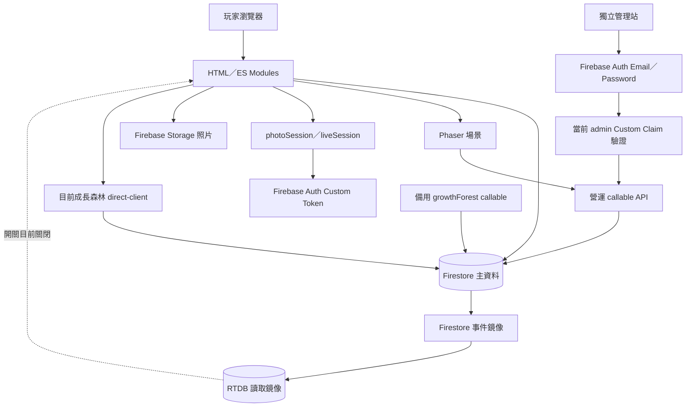

# Nexus 系統架構

> 程式盤點日期：2026-11-09。依儲存庫靜態分析整理，不代表正式環境的部署／規則驗證結果。本文為目前架構入口；舊版 [系統規格](system-specification-and-architecture.md) 保留其版本日期，不作為現行開關依據。

## 1. 系統邊界

Nexus 是群組生活協作網站，整合聊天、行事曆、待辦、記帳、Photo Dump、餐食決策、成長森林與遊戲。咕咕村落以養雞、產蛋、村落互動及怪物戰鬥為核心。營運中心是獨立頁面及後端 codebase，處理公告、禮包與遊戲營運管理。

| 元件 | 實際技術／入口 | 責任 |
| --- | --- | --- |
| 玩家網站 | 多頁 HTML、原生 ES Modules、CSS；`index.html`、`js/main.js` | 生活功能與個人外觀，部分腳本仍內嵌 HTML |
| 遊戲 | Phaser 3.60.0；`js/farm/entry.js`、`js/growth-forest/scene.js` | Canvas 場景、動畫與互動；不是整站前端框架 |
| 記帳圖表 | 按需載入 Chart.js 4.6.1 | 視覺化統計，不阻擋基本帳務清單 |
| Firebase Web SDK | 模組從 CDN 匯入，多數使用 12.19.0 | Firestore、Auth、Storage、Functions 與選用 App Check |
| 主後端 | Node.js 22、Firebase Functions v2、Admin SDK；`functions/`，codebase `nexus-live` | 舊制登入橋接、RTDB 鏡像、成長森林 cloud 服務 |
| 營運後端 | `game-admin/functions/`，codebase `nexus-ops` | 管理權限驗證、公告查詢、禮包原子兌換、護衛犬交易 |
| 主資料庫 | Cloud Firestore | 生活資料、農場、成長森林與營運資料 |
| 其他儲存 | Firebase Storage、Realtime Database、本機 Storage | 照片檔案、選用讀取鏡像、頁面偏好／暫存 |

玩家前端不需全站編譯；仍有特定遊戲模型及素材的產生腳本。`direct-domain.js`、`direct-service.js` 是共用來源轉換產物，不應直接維護。詳見 [開發規範](DEVELOPMENT_GUIDE.md)。

## 2. 元件互動

這些是並存的路徑：不能把所有玩家寫入都描述為經後端，也不能把 RTDB 描述為第二個獎勵發放資料庫。Firebase Rules 與後端驗證必須各自核對。

## 3. 頁面與導覽

- 主頁 `index.html` 引入 `main.js`，並載入 `auth.js`、`group.js`、`dashboard.js` 的共用 window 介面。
- 右側功能選單透過 `window.navTo(url, moduleName)` 跳轉完整 HTML 頁面，並延後補送操作足跡。
- `app-navigation.js` 建立原生連結，底部入口帶 `?nav=1`。頁面用 `data-app-page` 及 navigation entry 狀態決定標題／返回呈現；不是 SPA Router。
- `navigation-config.js` 依 `users.menus`、`userSettings.navigation.items`、排序及帳號快取解析項目，最多六個功能，另加首頁。
- 成長森林保留 `wishwall.html` 與 `wishlist` 功能鍵，相容舊連結；頁內有自己的森林／紀錄／獎勵／家長／成員導覽。
- 玩家站的 `admin.html` 與獨立的 `game-admin/site/index.html` 用途及權限來源不同。

## 4. 身分驗證與群組

### 4.1 固定識別

| 識別 | 意義 | 不可假設 |
| --- | --- | --- |
| accountId | 玩家固定帳號，成員、作者與農場關聯的主要鍵 | 不能以 name 取代 |
| users 文件 ID／docId | 頂層 users 實際文件鍵；舊資料可能隨機，新註冊使用 `account_...` | 不一定等於 accountId |
| Firebase Auth UID | custom-token 橋接用 users 文件 ID；管理員為獨立 Auth 帳號 UID | users.role 不等於 Auth admin claim |
| groupId | 所選群組 | user.groupId 只是歷史／單一群組提示，不代表完整成員資格 |
| name／nameHistory | 目前顯示名與歷史別名 | 同名不能任意綁定到其中一位玩家 |

### 4.2 玩家與管理員流程

玩家主站仍有舊制登入：`auth.js` 查詢 users，核對既有驗證欄位並保存登入上下文；`findAccountsById` 為相容大小寫，目前會掃描 users。瀏覽器保存的角色與帳號不是可信任授權證明。

需要 Firebase Auth 的照片／營運功能呼叫 `photoSession`，由後端核對唯一帳號、舊制憑證、未停用狀態及 groups.members，再簽發 custom token。不同客戶端使用具名 Firebase App，避免相互覆寫登入工作階段。不應記錄傳入憑證或 token。

獨立管理站以 Email／Password 登入 Firebase Auth。`gameOpsAdmin` 同時驗證 token 的 `role: admin` 與 `auth.getUser(uid)` 的目前 claim／停用狀態；一般 users 的 admin／parent 無法據此取得營運管理權。MFA 為選用，已綁定的因素仍依 Firebase 原生流程完成。

目前管理、公告、禮包及護衛犬的 App Check 政策見 `game-admin/functions/callables.cjs`：管理及禮包預設選用，公告與護衛犬未強制。這不取消登入、成員、對象與交易檢查。

### 4.3 群組隔離

`group.js` 保存 `lastGroupId` 和 `nexus_active_group_id`。遊戲共用 `game-context.js` 優先採 lastGroupId，`game-members.js` 再驗證 groups.members，跨分頁換帳號或群組時重新載入。

資料隔離有兩類：頂層集合查詢帶 `where('groupId','==',...)`；農場與森林則使用 `groups/{groupId}/...` 路徑。聊天另核對 participantIds。舊打卡、全站通知及部分姓名邏輯不完全遵循此模式，見 [既有問題清單](DOCUMENTATION_AUDIT.md#既有問題與待確認事項)。前端篩選只控制畫面，不能證明 Rules 已保護資料。

## 5. 資料與生命週期

- 首頁重建先集中解除監聽並提升世代；成員頭像稍後補載，不阻塞主要功能。
- 聊天依房間替換即時監聽，30 筆游標分頁，不以單日截止刪除歷史。
- 相簿按已載入範圍訂閱；離頁停訂閱，恢復時確認帳號與群組。
- 農場 Boot 先等成員資格，再啟動跨場景存檔 session；公開素材與資格確認可平行。
- 成長森林目前 `GROWTH_TRANSPORT='firestore'`。共用服務由建置腳本產生瀏覽器版本，透過群組修訂文件協調交易；不能將這種前端檢查當作後端資源防作弊。
- 營運發獎、金幣調整與新租犬交易以 Firestore 為權威，冪等收據保護重送；RTDB 鏡像為非同步。

完整效能生命週期見 [PERFORMANCE.md](PERFORMANCE.md)，集合與欄位見 [DATABASE.md](DATABASE.md)。

## 6. 部署與未知範圍

GitHub Pages、`nexus-live`、`nexus-ops`、索引、Rules 與資料遷移是不同發布單位。Git push 不等同 Firebase 後端更新；改前端註解也不需要部署 Functions。此文件化任務禁止部署。

正式 Firestore Rules 未在儲存庫；RTDB／Storage Rules 及測試／片段雖存在，不能證明目前正式環境已使用它們。正式 IAM、Auth／App Check Console 配置、目前部署版本與資料保留政策皆待確認。不可用 Emulator 全拒絕規則取代現行正式規則。
