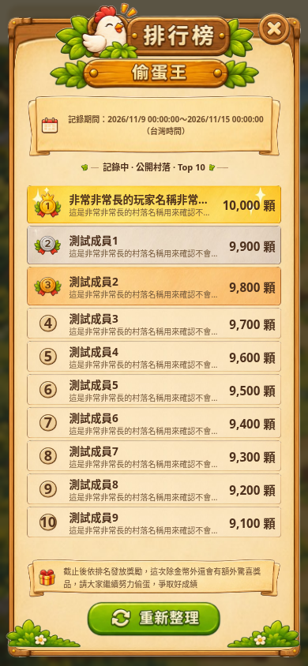
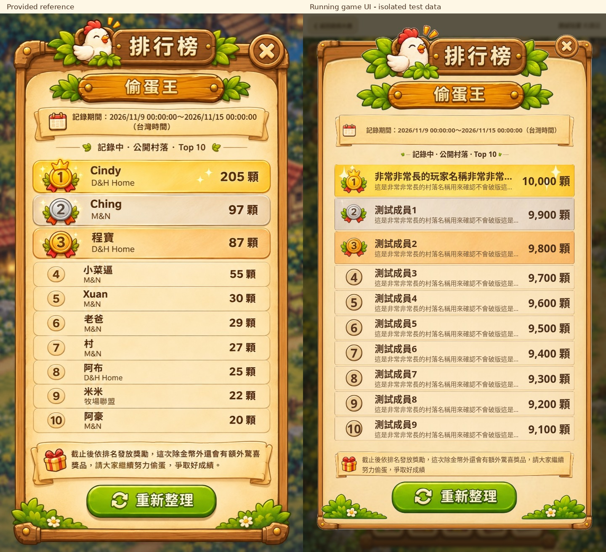

# 咕咕村落排行榜 UI V2 交付報告

日期：2026-11-13。本次只修改排行榜 DOM、圖片、CSS 與畫面層的請求狀態防護；未修改養雞、偷蛋統計、活動週期、玩家／村落資料結構、Security Rules 或發獎規則。未部署正式環境。

## 1. 開發前盤點

| 項目 | 實際來源／行為 |
| --- | --- |
| 入口 | `js/farm/ranking-ui.js` 的 mountFarmRankings 建立 farm-ranking-launcher；`js/farm/hud-ui.js` 將同一入口移入側邊 HUD，沒有新增入口 |
| 彈窗 HTML | ranking-ui.js 動態建立 overlay、dialog、分類、期間、狀態、榜單與頁尾；不是 HTML 內的靜態榜單 |
| 舊 CSS | css/farm-mail.css 與通知共用基礎樣式；新視覺限制於 css/farm-ranking.css，不改通知樣式 |
| 查詢 | js/farm/rankings.js：先檢查目前群組成員資格，列出公開村落，取得有效 users 個人資料及 groups/{groupId}/users/{accountId}.farm，再確認村落仍公開、玩家仍是成員 |
| 查詢並行 | 現有資料層每批四個村落、每批十個 accountId；此次未修改 |
| 排名 | js/farm/ranking-core.js：目前期間欄位分數降冪，同分依 accountId、groupId 排序，最多十筆。同帳號在不同村落分開計算；呈現層不重新排序 |
| 類型 | FARM_RANKINGS 目前只有 stolenEggs／偷蛋王；仍逐項建立分類，未刪除類型切換機制 |
| 期間 | ranking-core.js 的 THEFT_RANKING_START／END 與 config.period；目前仍是專案設定的 2026/11/9～11/15 台灣時間，並非這次加入的 Firebase 活動設定查詢 |
| 狀態 | theftRankingStatus 使用現有時間邊界：尚未開始／記錄中／已截止；開啟與邊界計時沿用原流程 |
| 獎勵 | config.note 提供原活動說明。排行榜模組原本沒有自動結算或發獎程式，這次沒有新增或宣稱已實作 |
| 監聽／生命週期 | 排行榜用按需 getDoc/getDocs，沒有額外 onSnapshot；原 launcher 監聽 registry，game destroy 解除監聽、移除 DOM、清除邊界計時器 |

資料取得沿用既有前端 Firestore 流程，沒有轉換成 Cloud Functions 或改動正式資料授權。

## 2. 素材與原圖

已實際讀取提供的兩張 JPEG：素材表 1280×960，版面稿 720×1280，原檔保留於 `assets/farm/leaderboard/source/`。未使用整張設計稿當遊戲背景。

切圖由 `scripts/extract-leaderboard-assets.py` 產生，外部連通白底去背並處理外緣 white-matte；不是 AI 重新生成。`manifest.json` 記錄來源 SHA-256、矩形與尺寸；`scripts/verify-leaderboard-assets.py` 驗證原檔、裁切、透明度及不透明區域像素。

| 用途／素材 | 檔案 |
| --- | --- |
| title | `assets/farm/leaderboard/leaderboard_title.png` |
| close | `assets/farm/leaderboard/leaderboard_close.png` |
| category | `assets/farm/leaderboard/leaderboard_category.png` |
| panel | `assets/farm/leaderboard/leaderboard_panel.png` |
| period_banner | `assets/farm/leaderboard/leaderboard_period_banner.png` |
| divider | `assets/farm/leaderboard/leaderboard_divider.png` |
| row_gold | `assets/farm/leaderboard/leaderboard_row_gold.png` |
| row_silver | `assets/farm/leaderboard/leaderboard_row_silver.png` |
| row_bronze | `assets/farm/leaderboard/leaderboard_row_bronze.png` |
| row_normal | `assets/farm/leaderboard/leaderboard_row_normal.png` |
| medal_gold | `assets/farm/leaderboard/leaderboard_medal_gold.png` |
| medal_silver | `assets/farm/leaderboard/leaderboard_medal_silver.png` |
| medal_bronze | `assets/farm/leaderboard/leaderboard_medal_bronze.png` |
| gift | `assets/farm/leaderboard/leaderboard_gift.png` |
| sparkle | `assets/farm/leaderboard/leaderboard_sparkle.png` |
| reward_banner | `assets/farm/leaderboard/leaderboard_reward_banner.png` |
| refresh | `assets/farm/leaderboard/leaderboard_refresh.png` |
| grass_left | `assets/farm/leaderboard/leaderboard_grass_left.png` |
| grass_right | `assets/farm/leaderboard/leaderboard_grass_right.png` |
| calendar | `assets/farm/leaderboard/leaderboard_calendar.png` |
| rank_normal | `assets/farm/leaderboard/leaderboard_rank_normal.png` |

完整原始裁切座標請見素材資料夾 README 與 manifest。

### 素材限制／待補

1. 素材表是白底 JPEG，不具原始透明 alpha；壓縮邊緣、陰影透明度與白邊處理無法保證等同原生透明 PNG。已檢視深色底素材對照，沒有整片白底、鄰近元件碎片或缺失的右框，但不能宣稱逐像素還原。
2. 一般名次原圖印有固定 4；沒有把它用於全部名次，也沒有抹字冒充完整原稿。採用每日任務既有空白圓章，4～10 為 DOM 動態文字。圓章材質與設計稿略有差異；若要求完全一致，需要補無文字的一般名次徽章。
3. 金色列原素材自帶星光；獨立 sparkle 已切出但未重複疊加，也未加入持續動畫。
4. 只有偷蛋王分類是目前真正固定的圖中文字。其他動態資料均不烙印在圖片中。

## 3. UI 架構與功能整合

- 主框、期間與獎勵卷軸、排名列採原 PNG 的九宮格伸縮；標題、關閉鍵、獎章與重新整理按鈕維持原圖比例。
- 固定上區：雞隻標題、關閉鍵、分類、真實期間及動態狀態。中區為獨立可捲動的 Top 10；下區是原獎勵說明與重新整理鍵，不以 absolute 蓋住榜單。
- 玩家及村落名稱透過 textContent 填入，過長採省略並保留 title；分數沿用查詢結果並以 zh-TW 千分位顯示。
- 未有資料時有空榜提示；查詢錯誤顯示原錯誤及可用的重新整理入口。
- 同一類型的進行中查詢在快速關閉／重開時共用，沒有新增長期資料快取。重新整理載入時停用，完成後有 1.2 秒手動冷卻；保留目前分類。
- version／disposed／overlay.hidden 防止關閉或過期請求重新更新彈窗及排程。只在目前請求完成時解除載入狀態。
- 原鍵盤焦點循環與 Escape／遮罩關閉保留；可捲動榜單也可取得鍵盤焦點。開啟時沿用原方式鎖定遊戲輸入，關閉還原，不重新初始化 Phaser、不重載頁面。
- 遮罩阻止 pointer、touch、wheel 事件向遊戲冒泡。尊重 safe-area，極短畫面縮小標題與固定區，讓榜單保有可捲動高度；非常長的獎勵說明另有可捲動上限。

## 4. 視覺比對

以 720×1280 的實際遊戲頁面截圖與版面稿並排檢視，並修正曾出現的標題／分類遮疊、名次列過高與內距差異。未使用靜態 HTML 預覽代替遊戲執行。

| 元件 | 參考稿約略位置（720×1280） | 實作策略 |
| --- | --- | --- |
| 主框 | x32～689，y62～1260 | 原圖九宮格、響應式寬高、安全區 |
| 標題 | 上方中央，略突出木框 | 原雞隻標題 PNG，按比例縮放 |
| 關閉 | 右上角，約 x593、y48 | 原圓形 PNG，觸控寬高至少 44px |
| 分類 | 約 x115、y142 | 原偷蛋王木牌 PNG，保留分類控制 |
| 活動期間 | 約 x78、y224 | 原卷軸、日曆 PNG、動態文字換行 |
| Top 10 | 約 x78、y348 至 y999 | 原前三名底板／獎章及一般列底板，獨立捲動 |
| 獎勵／重新整理 | 約 y1018～1205 | 頁尾在正常排版流程中，不遮擋榜單 |

尚有差異：原素材表與完整設計稿本身的木框、草叢尺寸不完全一致；圖片來自素材表而非重新畫成另一套。小螢幕以可讀字級與獨立捲動處理，顯示列數及文字換行會與設計稿不同。一般圓章、JPEG 邊緣與九宮格中的羊皮紙紋理伸縮也無法宣稱完全一致。未加入額外燈光、花朵或新的持續特效。

## 5. 測試結果

- `node --test tests/farm-ranking.test.mjs`：4 項通過，涵蓋公開／私密村落、移除成員、同帳號跨村落分離、去重、Top 10、同分排序、期間起迄及只累積本期紀錄。
- `FARM_RANKING_ONLY=1 node tests/farm-mail-browser.cjs`：通過。使用實際 farmgame.html、CSS、排行榜資料層與 Phaser，Firebase 由隔離 fixture 供應；不是正式玩家資料或正式網路驗收。
- UI 案例：空榜、1 人、2 人、Top 10、極長暱稱／村落、10,000 顆、一般 4～10 名動態數字、正確分類與期間、重新整理、進行中重複點擊、短冷卻、Firebase 查詢錯誤、快速開關、活動截止、關閉後輸入還原及場景實例不變。
- 尺寸：320×568、375×667、390×844、430×932、412×915、768×1024、720×1280、844×390。逐一檢查畫面邊界、無水平溢出、最後一名可捲到、頁尾不覆蓋榜單及關閉鍵觸控尺寸。
- 完整 `node tests/farm-mail-browser.cjs` 回歸通過：通知、領獎重試、批次刪除、未讀狀態、群組隔離、HUD、拜訪偷蛋與現有排行榜流程。
- 素材來源驗證、JS 語法及 Git diff 空白檢查通過。
- 未執行 iPhone／Android／iPad 真機或 WebKit 測試。不同尺寸的 Chromium 截圖不等於真機驗收。

測試需先於專案根目錄啟動 `python3 -m http.server 8012 --bind 127.0.0.1`，瀏覽器依現有測試環境使用 `/usr/bin/chromium` 與 Playwright。

## 6. 修改檔案

- `farmgame.html`：載入排行榜專用 CSS。
- `js/farm/ranking-ui.js`：素材式呈現、千分位、空榜及查詢狀態防護，保留既有資料層。
- `css/farm-ranking.css`：新增排行榜限定版面與九宮格美術。
- `assets/farm/leaderboard/`：21 張 PNG、原始兩張 JPEG、素材說明與 manifest。
- `scripts/extract-leaderboard-assets.py`、`scripts/verify-leaderboard-assets.py`：可重現裁切與來源驗證。
- `tests/farm-mail-browser.cjs`、`tests/helpers/farm-ranking-checks.cjs`：隔離讀取探針與排行榜測試。
- `docs/FARM_LEADERBOARD_UI_V2.md`、`docs/screenshots/farm-ranking-v2-*`：交付報告與實際執行截圖。

未修改 `rankings.js`、`ranking-core.js`、Firebase 設定或任何正式資料。尚未提交／推送或部署；此次前端更新不需要 Firebase Functions 部署。
