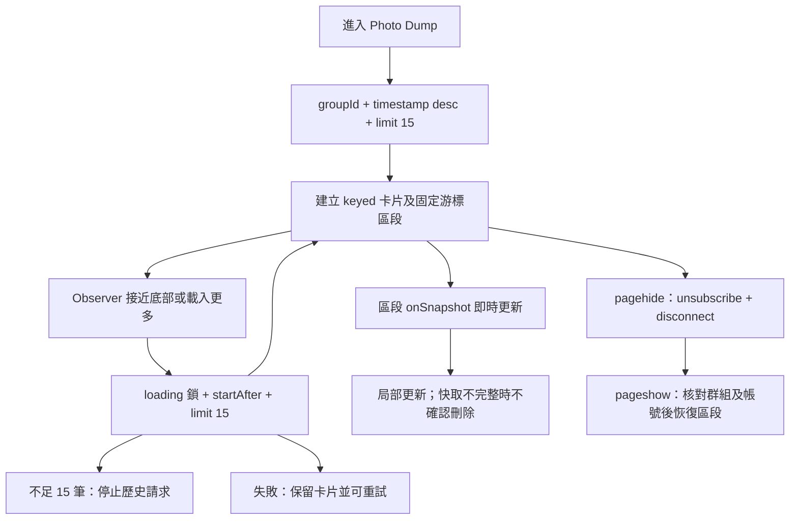

# Nexus 第四階段 Photo Dump 效能報告

基準版本：963e5eb。保留原生 MPA、Firestore、既有 Storage 上傳流程；RTDB 開關、資料結構與 Security Rules 未修改。沒有建立正式測試資料。

## 根因與修改

1. 原本群組照片 onSnapshot 沒有限制，初始化下載所有歷史。現在 getDocs 使用 groupId 相等、timestamp 降冪、limit(15)、startAfter(DocumentSnapshot)。每批查詢後建立固定游標區段的即時訂閱，第一段使用 endAt，後續使用 startAfter + endAt。快照游標包含文件 ID，可處理同時間與游標文件刪除。
2. 原本每次通知清空 feedContainer，重建圖片、留言與輸入框。現在以文件 ID 保存卡片，只新增或移除必要卡片，更新對應按讚列、文字及留言節點；未改變圖片不會重新建立。排序移動既有卡片。Enter 使用一個容器事件代理，保留草稿與輪播位置。
3. 原本圖片沒有 lazy/async 或比例預留。現在照片與頭像使用 lazy、async，照片預留 4:3，頭像有尺寸。沒有新增縮圖後端或改 Storage 路徑。原始照片仍是顯示來源；新上傳原本已有最長邊 1200px 壓縮。舊大圖不會自動縮小傳輸量。
4. 監聽器原本沒有保存 unsubscribe。現在 pagehide 解除所有區段訂閱、Observer，generation 防止過期非同步結果寫回；pageshow 恢復同份 DOM 與區段，不重新查詢歷史分頁。恢復前核對 accountId 與 groupId。
5. 留言刪除改為 arrayRemove 精確物件，避免整份 comments 覆寫同時新增留言。貼文仍維持原有陣列格式，沒有每篇另開留言 Listener。
6. 塗鴉貼紙的 window 拖曳事件原本清除貼紙後仍保留，現在 AbortController 在清除／移除貼紙時解除。

## 分頁及即時流程

歷史區段互斥、文件 ID 去重；新貼文進入最上方區段，已載入歷史繼續即時接收按讚、留言及刪除。即時錯誤有重新連線按鈕。初次空相簿也保留新文監聽。快取回應不會宣告歷史已讀完，不完整快取快照不直接移除已確認卡片。

**成本與限制：** 不是全程固定 15 篇。每批 getDocs 後的 Listener 初始快照可能再傳回相同文件，因此隔離模型每批最多 30 筆；10 篇小相簿從 10 增至 20 筆。即時頭段沒有新文數量上限，長時間大量新增仍會成長。讀完全部歷史仍保留全部 DOM，沒有虛擬化。這次移除的是「每次進入讀取全部歷史」，不能宣稱所有情境都沒有無界成本。

按讚／留言數仍是陣列，不能在不加欄位的情況下做伺服器全站計數排序；選單明確標示只排序已載入貼文，捲入下一批後會重新排序。這是分頁帶來的可見行為差異。

索引與舊查詢相同：photos 的 groupId ASC、timestamp DESC（含隱含文件 ID 排序）。游標與 limit 不增加新的欄位組合。專案沒有 Firestore 索引清單，正式索引及 Rules 尚未連線驗證；缺索引會顯示可重試錯誤，不會退回全站掃描。

## 測量方法與限制

本地 Chromium 390×844，HTTP 隔離伺服器，以 git show 提供修改前程式。Firestore 完全使用記憶體替身，無正式讀寫。一般 SDK 延遲 20ms，弱網模型為 SDK 延遲 180ms，**不是完整限速行動網路**。每個組合單次樣本，不是統計分位數。背景工作與瀏覽器排程可能影響數據。

每篇 1 圖、1 留言；另測 100 篇各 50 留言。圖片為小 SVG，無法代表實際 JPEG 解碼及傳輸。首批時間以 MutationObserver 觀察第一批卡片插入；不是 FCP 或可操作時間。文件數是替身傳回數，不是正式 Firebase 帳單。JS 為 CDP ScriptDuration 計數器，不能視為全部主執行緒成本；TaskDuration 包含其他渲染工作且觀察窗受測試等待影響。Heap 未強制 GC，不證明長期無洩漏。完整數據見 gallery-performance-phase4-results.json。

## 首批比較

|情境／篇數|文件傳回 前→後|卡片 前→後|DOM 子節點 前→後|首批 ms 前→後|JS 計數器 ms 前→後|
|---|---:|---:|---:|---:|---:|
|一般／10|10→20|10→10|330→330|238.5→207.8|6.3→7.2|
|一般／100|100→30|100→15|3300→495|188.0→211.7|7.4→5.6|
|一般／500|500→30|500→15|16500→495|283.9→238.3|38.8→8.8|
|一般／1000|1000→30|1000→15|33000→495|334.6→207.1|7.3→7.7|
|SDK 慢回應／10|10→20|10→10|330→330|400.4→345.7|6.2→7.9|
|SDK 慢回應／100|100→30|100→15|3300→495|356.9→351.5|6.5→9.4|
|SDK 慢回應／500|500→30|500→15|16500→495|417.4→336.0|8.8→8.2|
|SDK 慢回應／1000|1000→30|1000→15|33000→495|508.0→264.8|15.3→7.4|
|每篇50留言／100|100→30|100→15|47400→7110|577.9→269.2|12.1→7.9|

1,000 篇首批文件傳回模型從 1,000 降至 30，DOM 從 33,000 降至 495。小相簿讀取增加，部分組合時間沒有改善，JS 計數器也沒有一致改善；不能宣稱所有載入都更快。

一般 1,000 篇初始 Long Task 原樣本有 257ms，修改後該樣本沒有；弱回應修改後仍有 74ms。一般初始 JS heap 約 5.36MB→3.39MB，但不是長時間記憶體成長測試。圖片 ResourceTiming 只包含已完成請求，原先 1,000 篇樣本約 237 個完成，修改後 4 個；不能當作原先總請求只有 237。額外 images 樣本記錄實際發起請求數。解碼成本、捲動 FPS、iPhone Safari／iOS PWA／Android 真機、正式網路及帳單讀取均**尚未測量**。

## 功能與穩定性驗證

- 10、100、500、1,000 篇與逐批讀完：數量正確、無重複。下一批 15 篇的替身傳回量實測為 30（查詢＋即時初始快照）。
- 快速觸發 Observer 20 次只送一次下一批請求；無更多資料後不繼續請求。
- 原生 IntersectionObserver：15→30→35；空相簿後加入多篇仍即時顯示。
- 同時新增 3 篇、相同時間、游標文件刪除與還原、歷史按讚、留言更新、分頁失敗重試、不完整快取快照測試通過。
- 按讚保留同一圖片／留言節點及草稿；10 次連續按讚與留言通過；精確留言刪除保留同時新增留言。
- 20 次生命週期清理：暫停後區段 Listener 與 Observer 均為 0；恢復無重複。20 次真實換頁及瀏覽器返回皆觀察到同份文件恢復。20 次貼紙建立／清空後 window 拖曳事件數回到基準。
- 群組 B 測試貼文不顯示；恢復時群組已切換則導回首頁。這是客戶端隔離回歸，不能取代正式 Rules 驗證。
- 原有 gallery-storage-browser、Storage 4 項單元測試、navigation-loading 全套、navigation-browser 通過。第二階段 performance-init 20 輪清理回歸為 0。
- 尚未測試正式帳號、實際 Storage 上傳及真機觸控；沒有擅自部署 Firebase。

執行：`node tests/gallery-performance.cjs`、`node tests/gallery-pagination-browser.cjs`；`BASELINE=1 BENCH=1` 跑修改前初始基準，`SLOW=1` 跑 SDK 慢回應模型，`COMMENTS=50 COUNTS=100` 跑大量留言。

## 修改檔案及風險

應用：js/gallery.js、css/gallery.css、gallery.html。
測試：tests/gallery-performance.cjs、tests/gallery-pagination-browser.cjs、tests/fixtures/gallery-performance-sdk.js；既有 tests/helpers/navigation-performance-server.cjs、tests/fixtures/navigation-performance-sdk.js、tests/gallery-storage-browser.cjs、tests/navigation-browser.cjs 補游標替身能力。
文件：本報告與 gallery-performance-phase4-results.json。

主要修改風險為區段邊界、快取／即時回應次序及排序範圍變更，已有對應隔離回歸。未新增套件、Functions、欄位、Rules 或 RTDB 變更。

## 後續建議（未實作）

先在真機與正式唯讀量測確認圖片大小、FPS、記憶體及讀取費用。再評估縮圖流程：額外 Storage 物件、Functions 觸發費用、IAM、驗證與舊圖回填都需獨立設計，本次沒有直接導入。若實際持續瀏覽數百篇仍吃記憶體，再規劃保留草稿、捲動位置與圖片檢視器的 DOM 虛擬化。大量留言陣列仍隨貼文整份傳輸；全域熱門排序與留言獨立分頁需資料模型另案評估。沒有開始第五階段。
