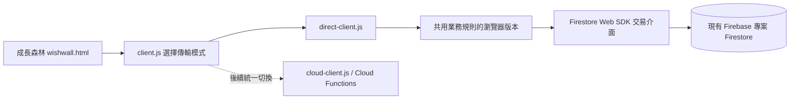

# 成長森林：前端 Firestore 暫行模式

日期：2026-11-05。依專案擁有者後續要求，先讓成長森林使用既有 Nexus 的前端 Firestore 存取方式；可信任後端與完整權限切換留待統一處理。本文件優先於 Phase 1 原開發／測試報告的「僅經後端寫入」描述。

> 後續土地擴充與資源流程，請見[土地擴充與獎勵說明](growth-forest-expansion-and-rewards.md)。

## 現行路徑



- `js/growth-forest/transport.js` 的 `GROWTH_TRANSPORT` 現為 `firestore`。
- 使用共用的 `firebase-config.js`、目前 Nexus 帳號與群組；向 `users` 以 `accountId` 查詢最新個人資料，向 `groups` 取得最新成員。未另外要求 Firebase Auth 登入，也不呼叫 `photoSession` 或 `growthForest`。
- 考試、閱讀、家長審核、規則、購種、種植、澆水、獎品申請與發放，改為直接讀寫原有 Firestore 路徑。保留紀錄、流水帳、請求收據與資源計算規則；不清空、重建既有資料。
- 歷史資料初始化仍只執行一次，不重複發放歷史獎勵；暫行模式不新增正式後端切換標記 `settings/growthForestCutover`，也不移除既有標記。
- 頁面保留表單鎖定、失敗提示、重試及帳號／群組切換檢查。

## 交易與程式共用

瀏覽器業務規則由 `functions/growth-domain.cjs`、`functions/growth-service.cjs` 產生，避免維護兩套獎勵公式。生成檔位於 `js/growth-forest/direct-domain.js` 與 `direct-service.js`，請勿直接修改生成檔。

```sh
node scripts/build-growth-direct.cjs
# 原有部署準備命令也會生成瀏覽器版本
node scripts/prepare-growth-forest.cjs
```

瀏覽器以 Web Crypto 計算 SHA-256，與後端的文件 ID／請求指紋一致。交易保留原先的重複紀錄檢查、冪等收據、兌換保留額度及資源不足檢查。

Firestore Web SDK 不支援在交易中讀取 Query。介面先查詢候選文件，再於交易內重新讀取各文件，並以 `groups/{groupId}/growthSync/main` 的版本序列化所有暫行模式業務交易。版本衝突由 SDK 重試，避免兩個前端同時新增時漏掉檢查；所有交易讀取均在 SDK 寫入前完成。此機制只協調遵循本介面的寫入，無法約束其他程式或惡意寫入。

目前優先使用單一 `accountId` 查詢，其餘篩選／排序在前端完成，避免依賴尚未部署的複合索引。每次候選查詢上限 2,000 筆，超過會明確停止並提示，不會靜默截斷；大量歷史資料仍應切回後端。此暫行方案會增加讀取量，群組共用版本也會增加大量同時操作時的衝突。

## 考卷照片

新照片在瀏覽器縮小為最長邊 1,280 像素並轉成 JPEG，壓縮資料 URI 最大 650,000 字元，存於：

`groups/{groupId}/growthExamPhotos/{firestore_UUID}`

欄位為 `accountId`、`groupId`、`dataUrl`、`contentType`、`createdAt`。紀錄沿用 `growth-exams/{groupId}/{accountId}/firestore_UUID.jpg` 相容參照，不需要先串接 Storage 或 Auth／Functions。後端傳輸的照片讀取也保留此格式支援。舊 Storage 照片仍沿原有 Storage 路徑與權限讀取。

這會占用 Firestore 文件容量及讀取流量。統一後端時應規畫回到私密 Storage，並處理失敗提交留下的孤立照片；目前未提供自動清理或刪除正式照片作業。

## 權限與正式環境界線

本次**沒有修改、放寬或部署正式 Firestore Security Rules**。是否能讀寫仍由目前 Firebase 專案已部署的規則決定；若出現 `permission-denied`，需要檢查現行規則，不能靠前端檢查繞過。

前端帳號、群組、家長角色與獎勵驗證可被修改，不能視為可信任的防竄改授權。這是擁有者指定的相容暫行模式，不具備原本可信任後端的安全保證。

`growth-forest/firestore.rules` 仍是未部署的獨立嚴格 Emulator／未來後端模式規則：禁止瀏覽器直接寫入，故**不適用此暫行模式，不可直接拿來取代正式 Nexus 規則**。此次只加入未來已授權玩家／家長讀取自己／群組考卷文件的規則相容性。

本次未連線寫入正式 Firebase，未部署 Functions／Rules，未執行正式資料遷移。

## 後續切換

1. 統一驗證 Firebase Auth、Functions、App Check、索引、正式規則與既有前端流程，避免前後端版本混用。
2. 對帳既有森林資料與照片，確認所有業務寫入改由可信任後端處理。
3. 將 `transport.js` 改成 `cloud`，搭配前後端與規則一起發布；不是單改設定就視為完成資安遷移。
4. 後端工廠預設仍要求 Auth，`resolveContext` 僅由程式注入，沒有開放遠端請求指定／繞過驗證。

## 本次驗證

- 全專案單元測試：155 通過、0 失敗。
- 瀏覽器生成服務與後端服務的業務案例各 14 項通過。
- Web SDK 介面測試包含：文件型交易讀取、衝突重試、同時新增不重複入帳、禁止重複建立文件、唯讀交易不寫版本、篩選／排序／分頁與超量提示。
- 真實頁面與 Phaser 的隔離瀏覽器測試：手機 390px／桌面 1440px；孩子／家長流程、審核、資源、種植、重整、兌換、考卷照片壓縮儲存及家長讀取；確認不載入 Auth／Functions SDK、不呼叫 Cloud Functions、不新增正式切換標記。
- Firestore Web SDK 以具版本衝突與文件讀取限制的 fixture 取代；上述不代表已驗證正式 Firebase 權限，也不取代真實 Firebase Emulator 測試。

```sh
node --test tests/*.test.mjs tests/*.test.cjs
GROWTH_TEST_DIRECT=1 node --test tests/growth-forest-service.test.cjs
# 先在專案根目錄啟動 python3 -m http.server 8030
GROWTH_DIRECT_BROWSER=1 node tests/growth-forest-browser.cjs
```
