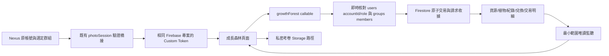

# Nexus 成長森林 Phase 1 開發報告

> **後續調整（2026-11-05）：** 依擁有者要求，現行版本改用前端直連 Firestore 的暫行模式。下列保留 Phase 1 原始交付紀錄；目前行為、限制及測試請見[前端直連說明](growth-forest-direct-mode.md)。

日期：2026-11-05（台灣）
工作分支：`feature/growth-forest-phase1`

## 1. 交付狀態與範圍

本次已實作 Phase 1 的前端、Phaser 場景、可信任後端、相容遷移程式與自動化測試。舊許願牆介面與前端直接寫入程式已移除；原始資料沒有刪除。保留 `wishwall.html` 網址及 `wishlist` 權限／選單 ID，避免既有捷徑與使用者權限失效。

**這是功能分支的開發與隔離驗證結果，不是正式環境已完成上線的宣告。** 本次未部署、未推送／合併 main、未對正式 Firebase 執行遷移或測試性發獎。真實 Emulator、正式 Security Rules 合併與 iPhone 實機驗收仍待完成。

工作開始前已存在的 `game-admin/DEPLOYMENT.md` 修改與 `game-admin/tests/callable-http.test.cjs`，屬前一項 CORS 排查工作；不包含在本次成長森林提交內。

## 2. 已實作功能

| 區域 | 可實際操作的功能 |
| --- | --- |
| Nexus 整合 | 主頁、側欄、選單設定與全域導覽改名「成長森林」；舊網址直接開啟新版。從 `?nav=1` 進入時保留 Nexus 底部導覽，森林內部選單改為頁內分頁，避免兩列選單重疊 |
| 孩子首頁 | 自己的森林、三種資源、三個種植位置、考試／閱讀／植物快捷按鈕；不顯示家長入口 |
| 家長首頁 | 經後端確認角色後預設進入家長管理；可切換查看自己的森林 |
| 考試 | 日期、科目／自訂科目、五種考試類型、分數／滿分、備註、選填私密考卷照片；驗證範圍、日期及分數上限 |
| 獎勵計算 | 由後端計算百分制區間獎勵；同科目／同類型的先前有效成績比較進步；可確認的歷史考試亦能作比較基準，但不重新發歷史獎勵 |
| 審核 | 考試預設待審核；家長核准才入帳；退回不發獎。待審核／退回紀錄可編輯重新送審；核准後僅家長可做差額更正／撤銷，留下歷史與補償交易 |
| 閱讀 | 手動日期、書名、分鐘、頁數、章節與心得；時間戳計時器開始／暫停／繼續／完成，背景及重新開頁仍可恢復 |
| 閱讀獎勵 | 預設每 20 分鐘一份：星星 10、水滴 15、金幣 5；預設每日上限 **1 份**，可由家長調整；未達門檻仍保存紀錄，預設自動核准 |
| 植物 | 每帳號／群組三格；初始向日葵種子一顆且不扣金幣。向日葵 50／100、鬱金香 80／150、櫻花樹 200／400（金幣價格／所需水滴） |
| 培育 | 每次澆水最多 10 滴，依 0／20／40／70／100% 換階段；成熟不再扣水，不足時顯示引導。植物不因離線枯萎 |
| 種子背包 | 購買先扣金幣並入背包，另選空格種植；每種種子上限 99 顆，避免無界庫存 |
| 森林畫面 | 專屬天空、遠景樹林、草地、土壤、路徑、三個位置；三品種共十五個不同階段 SVG sprite；待機、種植、澆水與升級效果 |
| 手機效能 | Phaser 僅森林頁載入；家長預設管理頁不載入引擎；省電 30 FPS、減少粒子、支援系統減少動態效果；背景暫停、離頁清除遊戲與監聽 |
| 家長查詢 | 孩子、日期範圍、類型、科目、考試類型、書名、狀態篩選及日期排序；分頁；考卷查看、核准／退回、紀錄更正 |
| 規則與概覽 | 成績區間、進步區間、閱讀門檻／資源／每日上限、審核開關；只影響新提交紀錄。當月考試／平均／閱讀分鐘頁數／可用及已兌換積分；可追溯手動星星加扣 |
| 夢想獎勵 | 家長新增、編輯、上下架；孩子申請、查看申請、取消尚未確認申請；家長確認、準備、發放、拒絕；歷史未完成申請可繼續處理 |
| 積分保留 | 申請只保留積分；發放才正式扣除；拒絕／取消解除保留；同一獎品不可同時建立多筆新進行中申請；完成後可再次申請 |

### 介面與素材

美術使用本專案原創 SVG 開發素材，不下載未授權圖片、不使用放大的 Emoji 作遊戲美術。十五個植物階段包含不同枝葉、花苞、花瓣、樹冠，並非單純縮放同一張圖。素材集中於 `assets/growth-forest/`，透過 `js/growth-forest/art.js` 管理；後續可替換正式插畫／Sprite Sheet。

目前為可驗收的開發視覺，沒有宣稱已達成正式手繪美術或獎項級視覺評審。

## 3. 架構與身分



- 沿用 `firebase-config.js`、`game-context.js`、`accountId`、`groupId` 及現有 `photoSession`。
- Firebase Auth UID 對應既有 `users/{docId}`；後端以該文件的實際 `accountId` 與角色為準，不信任 payload 帳號／角色或 sessionStorage 角色。
- `groups/{groupId}.members` 及目前 `users.role` 為沿用的群組家長授權模型；`parent`／`admin` 必須也是該群組成員。未新增第二套使用者或擅改 users／groups schema。
- 新增 `growthForest` 至既有 `nexus-live` codebase／`asia-southeast1`；只有呼叫此函式才載入成長服務，既有照片與同步函式不必初始化成長模組。
- 所有資源、紀錄、設定與獎品變更經 callable 處理。瀏覽器只能讀取允許的資料及上傳自己的照片，沒有資源寫入 fallback。

## 4. Firestore 資料結構

以下路徑均在 `groups/{groupId}/` 下：

| 集合／文件 | 用途 |
| --- | --- |
| `growthSettings/main` | 審核開關、區間與閱讀獎勵、每日上限、規則版本與伺服器時間 |
| `growthProfiles/{accountId}` | 三種資源、保留積分、已兌換積分、版本、初始等級 |
| `gardens/{accountId}` | 三個位置與按品種計數的 `seeds` 背包；背包與位置同文件，使種植扣種子保持原子性 |
| `gardenPlants/{plantId}` | 擁有人、品種、位置、累積澆水、階段、所需水量與種植時間快照 |
| `growthRecords/{recordId}` | 考試／閱讀內容、狀態、當時完整獎勵規則快照、比較基準、實發獎勵、審核者與時間 |
| `growthTransactions/{transactionId}` | 資源變更、前後餘額／保留額、來源、原因及操作者 |
| `growthRequests/{hash}` | 帳號＋requestId 的冪等收據及 payload 指紋；同 ID 改內容會拒絕 |
| `growthRecordKeys/{hash}` | 同一帳號相同核心紀錄內容去重，不因修改備註／照片就另發一筆獎勵 |
| `growthReadingDays/{hash}` | 帳號＋閱讀日期的已領份數，與發獎同交易更新 |
| `growthRewards/{rewardId}` | 夢想獎勵名稱、說明、價格、上下架；匯入舊獎品保留 legacyId |
| `growthRewardRequests/{requestId}` | 申請時的價格／名稱快照、保留狀態、發放狀態及歷史來源 ID |
| `growthRewardLocks/{hash}` | 同帳號／同獎品的新進行中申請鎖，結案後解除 |
| `growthRecordHistory/{changeId}` | 編輯／更正／撤銷的前後紀錄與原因 |
| `growthAudit/{operationId}` | 操作者、操作、對象、結果；設定與獎品包含前後差異 |
| `growthMigrations/{accountId}` | 來源筆數、積分、保留額、指紋、版本及遷移時間 |
| `settings/growthForestCutover` | 供正式規則切斷舊版直接寫入的切換標記 |

`pointsBalance` 包含尚未發放的保留積分，實際可用為 `pointsBalance - pointsReserved`。拒絕只解除保留，不重加一份已存在的餘額；完成發放才同時扣餘額與保留額。水滴、金幣為整數；星星保留兩位小數以相容舊積分。

資料時間由後端 `Date.now()` 產生 UTC epoch 毫秒，畫面以台灣時區顯示；活動日期為台灣曆日 `YYYY-MM-DD`。日期不得超過伺服器判定的今天。

## 5. 交易安全

- 交易內再次核對身分、群組成員與家長角色。
- 審核、發獎、每日額度、資源餘額、來源紀錄、收據、稽核同庫原子更新；沒有跨 Firestore／RTDB 的假交易。
- 核准只能由 pending 狀態執行；重複核准不發第二份獎勵。
- 購買價格、澆水量、成長需求與獎勵由後端設定計算，不採用前端傳入的資源數量。
- 進步基準是核准時已有效、事件日期較早（同日用提交時間）的同科目同類型成績；記錄比較基準，不因後續補登而改寫已核准獎勵。
- 已核准更正沿用原規則／比較基準，以差額入帳；撤銷以反向交易沖回。資源不足或星星已保留時拒絕撤銷，不產生負數、也不刪掉原獎勵明細。
- 閱讀頁數／章節不各自發獎；每日份數在交易內控制。更正書名／章節時，不因未來提高每日上限而撤回原本已合法取得的份數。
- 前端使用相同請求 ID 重試網路中斷的操作；提交中停用控制項，儲存成功但後續畫面同步失敗時，不誤報為尚未儲存。

## 6. 舊資料銜接與遷移

### 相容策略

原始 `scores`、`redeems`、`settings/wishWall` 與版本文件保留原處。使用既有 `js/wishwall-core.js` 的**同一份**積分算法，透過打包腳本送進 Functions，而非用新規則回算舊分數。

首次森林初始化會在交易內：

1. 讀取該帳號的舊紀錄、舊設定及來源版本。
2. 計算原可用積分；將未完成申請金額轉成保留額，已發放金額保留於已兌換統計。
3. 一次建立 wallet、garden、初始免費種子、開帳交易及遷移報告。
4. 群組首次建立設定時匯入原有有效獎品，價格不自行換算。
5. 原始歷史不複製成可再審核的新紀錄；新頁透過後端唯讀查詢歷史。舊未完成申請在新集合建立狀態覆寫，保留舊 ID，原始來源不改寫。

重複初始化遇到既有 wallet 直接沿用，開帳交易 ID 也固定，不能藉重整重新領種子或積分。負餘額、未知兌換狀態、非法成本會停止遷移並要求核對，不把數字任意歸零。

### 擁有者執行方式

預設 dry-run，只讀；`--apply` 才會依帳號交易建立新資料。請先完成資料匯出、正式 Rules 合併與舊寫入凍結安排。

```sh
node scripts/prepare-growth-forest.cjs
npm --prefix functions ci
node scripts/migrate-growth-forest.cjs --project homebasedb --group GROUP_ID --actor PARENT_ACCOUNT_ID --report growth-dry-run.json
# 確認報告、備份與正式切換計畫後，才由擁有者自行執行：
node scripts/migrate-growth-forest.cjs --project homebasedb --group GROUP_ID --actor PARENT_ACCOUNT_ID --apply --report growth-migration.json
```

- 本次**沒有執行正式 dry-run 或 apply**。已在隔離測試驗證重跑、舊成本、保留額、舊申請及原始文件不變。
- 報告列出無帳號紀錄、矛盾群組、每個成員的舊餘額與已遷移狀態；無帳號資料不按姓名猜測，須由擁有者確認歸屬。
- 初版安全上限：每帳號舊成績／兌換各 1,000 筆、群組舊獎品 100 個（新建獎品亦限制總數 100 個）。超過時停止並報告，不做不完整匯入；大規模分批遷移工具仍待擴充。
- 新預設考試星星尺度與舊規則不同，但舊獎品價格保持原值；上線前家長須檢視未來獎品價格，不能靜默變更既有承諾。

## 7. Rules、Storage 與索引

- `growth-forest/firestore.rules` 是獨立 Emulator 的最小權限政策：孩子僅讀自己資料、家長讀本群組；新增集合禁止所有前端寫入；伺服器 Admin SDK 才能寫入。
- **不可直接將這份全拒絕其他模組的測試政策部署取代 Nexus 正式 Rules。** 本 repo 沒有既有正式 Firestore Rules。須取得原規則，合併新集合的特定 matches，並移除會繞過限制的廣泛 allow。
- `growth-forest/legacy-cutover.rules.fragment` 說明如何在現有舊寫入授權中增加 `growthNotStarted(groupId)`。Firestore allow 是 OR，不是新增 deny 就能覆蓋舊 allow。
- 正式規則同時須防止一般使用者直接改自己的 `users.role/accountId` 與群組成員，否則會破壞沿用的身分模型。原有 Nexus 帳密／PIN 儲存與身分橋接未在本次重寫，亦須檢視 users 的敏感欄位讀取權限。
- `storage.rules` 新增 `growth-exams/{groupId}/{accountId}/{fileName}`：本人建立／本人及本群組家長讀取，禁止覆寫；JPEG／PNG／WebP，單檔最大 5 MB。只存私密 object path，不保存可長期公開分享的 download token URL；畫面授權讀 blob，關閉時撤銷 object URL。
- 已在 `firestore.indexes.json` 加入紀錄篩選排序、比較、交易、歷史及舊資料所需索引，未對正式專案建立索引。
- 三種資源只存 Firestore，與咕咕村落的 farm 金幣／雞蛋完全分離，不變更該遊戲經濟。

## 8. 啟動與部署邊界

本機需 Node.js 22、Functions 依賴與瀏覽器。只看頁面而未部署／啟動後端時，不會顯示假餘額或用瀏覽器直接發獎。

```sh
node scripts/prepare-growth-forest.cjs
npm --prefix functions ci
python3 -m http.server 8030 --bind 127.0.0.1
# 前端：http://127.0.0.1:8030/wishwall.html
```

正式發布前，依序取得完整正式 Rules、備份與檢查遷移報告、完成 Emulator 驗證、測試照片授權與 Storage CORS、合併索引及 Rules，再由擁有者確認 Functions 與靜態網站一起發布。`firebase.json` 的 predeploy 會打包原始舊計算模組；不要漏掉這個步驟。

本次未執行任何正式部署命令，既有 Nexus 正式站與咕咕村落未被本分支改動。

## 9. 檔案清單

### 新增

- `functions/growth-domain.cjs`、`functions/growth-service.cjs`
- `js/growth-forest/main.js`、`client.js`、`scene.js`、`reading-clock.js`、`art.js`
- `css/growth-forest.css`
- `assets/growth-forest/forest.svg`、`README.md`，及 `sunflower-1..5.svg`／`tulip-1..5.svg`／`sakura-1..5.svg` 共十五個植物 sprite
- `growth-forest/firestore.rules`、`legacy-cutover.rules.fragment`、`firebase.json`
- `scripts/build-growth-art.cjs`、`prepare-growth-forest.cjs`、`migrate-growth-forest.cjs`
- `tests/growth-forest-service.test.cjs`、`growth-forest-clock.test.mjs`、`growth-forest-browser.cjs`、`growth-forest-emulator.cjs`
- 本報告與 `docs/growth-forest-phase1-test-report.md`

### 修改

- `wishwall.html`：以森林取代舊頁，保留網址
- `functions/index.cjs`、`functions/.gitignore`、`firebase.json`：後端與打包
- `storage.rules`、`firestore.indexes.json`：照片政策與新增索引
- `js/main.js`、`dashboard.js`、`menu-catalog.js`、`navigation-config.js`：顯示名稱
- `tests/wishwall-browser.cjs`：舊測試指令轉到新版完整流程；原積分算法單元測試保留
- `game-admin/tests/memory-db.cjs`：共用隔離 fixture 支援日期比較，不修改營運管理產品功能
- `tests/navigation-browser.cjs`：補齊既有記帳 SDK fixture 的 aggregate/documentId 匯出，驗證各模組導覽
- `README.md`、`docs/wishwall-data.md`、`docs/system-specification-and-architecture.md`：新模組連結與歷史說明

### 移除舊程式（不是資料）

- `js/wishwall.js`、`js/wishwall-store.js`、`css/wishwall.css`
- `js/wishwall-core.js` 保留，因它仍是舊積分遷移的唯一計算來源；Functions 的生成副本 `functions/game/wishwall-core.mjs` 由腳本產生、不提交。

## 10. 尚待驗證與已知限制

1. Firebase Emulator JAR 下載遭網路代理 403；真實 Rules、Storage 與 Firestore 原子交易整合測試未能執行，不能用記憶體測試替代宣稱。
2. 正式 Firestore Rules 未取得，權限合併、舊寫入凍結、身分欄位保護尚未實施；正式安全性需完成這些部署工作後才成立。
3. 正式 Firebase Auth 橋接、照片上傳／讀取 CORS、iPhone Safari/PWA 實機、網路斷線／重新登入仍需正式測試專案驗證；目前瀏覽器測試使用隔離 Auth／Firestore transport。
4. 美術為原創可替換開發向量，不是已完成正式插畫評審。
5. 三個位置不提供拔除／收成／換位；成熟植物保留欣賞，不繼續耗水。更多地塊、收藏與季節生態留 Phase 2。
6. 更正／撤銷若涉及已花掉的水滴／金幣或已保留積分，會拒絕而非建立負餘額；債務／家長資源追償工作流未加入。
7. 閱讀每日上限按閱讀日期與紀錄規則快照計算；不同內容仍可提交多筆，真實性不能僅靠計時器判斷，家長可開啟閱讀審核。
8. 已上傳但最終放棄表單的私密照片，未建立自動清理排程；後續可按未引用路徑與保留期做可信任清理。
9. 新紀錄頁每頁 20 筆、每次最多掃描 200 筆符合帳號／排序範圍的紀錄再套用其他篩選；若篩選稀疏可能需要繼續下一頁。不會假稱已一次搜尋所有歷史；大資料量可新增專用索引查詢／搜尋服務。
10. 未對正式資料執行任何遷移，也未部署、合併或推送 main。

## 11. Phase 2 建議

- 經家長確認的閱讀計畫、目標與低壓力引導，不以連續登入懲罰孩子。
- 原創正式 Sprite Sheet、音效、季節氣候與可減少動態的進階動畫。
- 更多地塊、成熟植物收藏／換位、裝飾品，但先驗證資源供需。
- 大量歷史資料分批遷移、細粒度監護關係、專用篩選索引與趨勢圖。
- 照片孤兒清理、保存期限與資料匯出／刪除治理。
- 真實裝置測試、效能與匿名化產品事件，觀察孩子完成核心流程的阻力。
