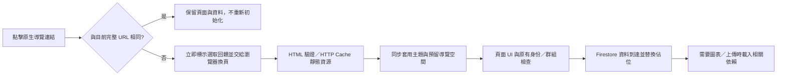

# Nexus 第三階段：頁面切換與底部導覽效能優化

日期：2026-10-28。修改前版本：`55eb456`。保留原生 HTML/CSS/JavaScript MPA、完整文件換頁及 Firestore；RTDB 讀取仍關閉。本階段沒有提交、推送或部署。

## 結論與改善邊界

已移除記帳本 Chart.js 對首屏解析的阻塞，將 Photo Dump 上傳依賴延後到實際操作才載入，提前預留導覽布局，加入原生換頁的即時回饋及靜態 Skeleton。記帳本冷載入及初始布局有明確改善；不能把這些結果解讀為整個 App 或所有暖切換都已變快。

MPA 切換仍會建立新文件、執行頁面模組與既有 Firebase 初始化。HTTP Cache 能省下載，不能省這些執行及資料往返。本階段沒有用淡出遮罩、延遲跳頁或假的進度條遮掩等待，也無法保證每個瀏覽器的文件提交過程完全沒有空白影格。

## 1. 基準方法與限制

- 實際執行原生 HTML／ES modules，使用本機 HTTP 伺服器及 Chromium，390×844 mobile/touch viewport。沒有使用 Playwright request routing，避免 routing 停用 HTTP Cache。
- Firebase SDK URL 在測試伺服器改寫成記憶體 SDK 替身，不連正式 Firebase；資料讀取固定延遲。Chart.js 使用從既有未指定版本 CDN 取得的真實 4.6.1 程式，保存在 `/tmp`，未加入專案套件或資產。
- 一般網路：CDP 30 ms latency、下載 2 MiB/s、上傳 1 MiB/s，SDK 每次讀取 60 ms。
- 弱網路：CDP 140 ms latency、下載 200 KiB/s、上傳 1 MiB/s，SDK 每次讀取 180 ms。
- Cold：先開啟來源頁，再清除 HTTP Cache 後點擊目標頁。不代表 OS DNS、CPU/JIT 及整個作業系統都處於冷狀態。
- Warm：目標頁先完整開啟，再開來源頁並點擊目標。伺服器明確使用 HTML `no-cache` + ETag、靜態資源 `max-age=300`。**這是控制條件，並非正式站的 Cache-Control 設定。**
- 六條路徑 × 兩種網路 × Cold/Warm，完整矩陣每格一次；另有一般 Warm 連續切換 20 次及三組追加對照。單次矩陣不是統計上顯著的真機比較。
- UI／資料就緒由文件內 rAF 探針記錄，避免自動化點擊等待 Load Event 後才計時。所有切換都以原生 anchor 觸發，文件識別碼確實改變；沒有攔截成 SPA。
- 「UI 可操作」是對應頁面處理函式與可見導覽已就緒的代理指標，不代表每張圖片或圖表都已完成。「資料就緒」另驗證目前群組的聊天室、行程、相片或正確 $125 帳務。
- JavaScript 時間使用 Trace 中 CrRendererMain 的腳本執行／編譯區間聯集，避免重疊事件重複加總。區間涵蓋換頁至資料與 Load Event 都完成，包含測試探針及 SDK 替身，**不是正式 Firebase SDK 的完整 CPU 成本，也不包含之後按需使用圖表的所有工作**。
- Resource Timing 只包含取樣時已完成的資源；晚到的圖表或快照後圖片可能仍在途。HTTP 伺服器回應大小不等於手機實際接收完的流量，Load Event 也不保證所有非同步照片已完成。
- 沒有 iPhone Safari、已安裝 iOS PWA 或 Android 真機；環境也未安裝 WebKit。沒有正式 LCP、INP、真機 FPS、堆積記憶體或正式 Firestore 帳單測量。
- Fixture 使用專案的 531 KB `Nexus.png` 當頭像，Cold 圖片成本不代表所有實際使用者頭像。正式站 URL／快取標頭尚未取得。

[完整指標、快取紀錄與追加對照](navigation-performance-results.json)

## 2. 全部底部導覽項目與流程

| 功能 | 文件 | 完整換頁 | 初始化重點 |
|---|---|---|---|
| 首頁 | `index.html` | 是 | 帳號驗證、個人設定、群組及小工具；沿用第二階段 generation 與清理 |
| 聊天 | `chat.html` | 是 | 先確認群組與成員，再啟動聊天室監聽；不能跳過成員驗證來加速 |
| 行事曆 | `calendar.html` | 是 | 可先建立月曆，事件由群組快照補入 |
| 記帳本 | `expense.html` | 是 | 分類與當月帳務平行；圖表本階段改為非阻塞載入 |
| Photo Dump | `gallery.html` | 是 | 瀏覽只需 Firestore；上傳相關 SDK 改為實際操作時載入 |
| 待辦 | `todo.html` | 是 | 保留群組初始化及原有 BFCache 返回重新載入防護 |
| 吃什麼／投票 | `food-decision.html` | 是 | 保留日期、餐別與群組流程；原頁內四個投票導覽維持 |
| 許願牆 | `wishwall.html` | 是 | 保留群組及人員權限、原有 BFCache 返回重新載入防護 |
| 到家打卡 | `checkin.html` | 是 | 保留原本身份與資料讀取；有相同導覽資源提示 |
| 遊戲區 | `games.html` | 是 | 直接進入大廳，維持隱藏底部導覽；未預載 Phaser 或遊戲資產 |

底部最多六個自選功能加固定首頁的規則、圖示、原生 href、功能權限過濾及 deferred activity log 都保留。只有「點擊完全相同的當前 URL」不再重新載入，避免重建同一頁的狀態、監聽器與查詢；其他頁面仍是完整換頁。



## 3. 三個主要瓶頸及採用方式

### P1：Chart.js 同步 CDN 腳本阻塞記帳本

原本 `expense.html` 的 `<head>` 有未指定版本的同步 Chart.js；它下載及執行前，後續 CSS、HTML 及導覽初始化都可能等待。

現在移除該同步標籤。`chart-loader.js` 以非同步 script、單一 in-flight Promise 載入固定 4.6.1 URL。此版本與本次實際下載的既有 CDN 版本一致。`renderPieChart()` 先更新正確金額，再等待圖表；回顧圖與圓餅圖共用載入。圖表各有 render version，較舊的非同步結果不能覆蓋新的篩選。失敗／逾時有重試，金額與導覽仍可用。

新 HTML 使用 `expense.js?v=navigation3`，避免移除同步標籤後誤用仍在快取中的舊腳本。已實測「新 HTML＋舊 unversioned JS 快取」及「舊 HTML＋新版 JS」相容。未對其他未指紋化資源擅自設定長期 immutable。

### P1：瀏覽 Photo Dump 先等待上傳依賴

原本 `gallery.js` 靜態匯入 `gallery-storage.js`，後者立即匯入 Auth、Functions、Storage，即使只是瀏覽相片也要載入、解析這個模組圖。

現在保留原有上傳與刪除呼叫介面，改在實際操作時 dynamic import；由原生 ESM 共用模組。雲端照片刪除前會先確認 cleanup 模組可用，避免 chunk 下載失敗卻已刪掉貼文資料；舊照片沒有 Storage 路徑則不需要載入 SDK。瀏覽不再載入這四個腳本（gallery-storage 及三個 SDK），也不會預先呼叫 photoSession。實際上傳／雲端刪除仍執行原有驗證、群組路徑限制及失敗清理。

### P2：MPA 重新初始化及導覽布局／狀態呈現較晚

完整換頁讓目前頁面模組重新執行；首頁、聊天等還需要原有 Firestore／權限往返。暖快取命中不能消除這些成本。本階段保留必要依賴，不以舊群組資料或未驗證身份填出假首屏。

低風險改善包括：

- 對目前頁面一定會使用的小型 `navigation-config.js` 加 modulepreload，讓它與既有 head 資源平行取得。沒有預載全部頁面或 Firebase 資料。
- 對 gstatic 加 preconnect，記帳本另提示 jsDelivr；本機同源 fixture 不能量測真實 DNS/TLS 節省，因此未宣稱它們有實測的毫秒收益。
- `?nav=1` 且存在登入上下文時，在第一個 paint 前標記布局，CSS 提前預留原有導覽高度及隱藏返回主選單按鈕。這不是授權判斷；頁面原本的權限與群組檢查仍執行。無效登入回到登入區時清除布局標記。
- 連結點擊立即顯示 `aria-busy`／原有主題選取底色，不延遲原生導航、不遮住內容。取消導覽、pagehide、pageshow 都會清理狀態；Ctrl／Meta 等原生操作不被攔截。清理用單個可取消 rAF，不新增持續 Timer。
- 保留既有導覽列固定位置、70px + safe-area 高度及圖示。手機瀏覽器的網址列與 safe-area 真機行為仍需實機確認。

## 4. 首屏與 Skeleton

聊天與 Photo Dump 初始等待區改為靜態形狀佔位；第一次快照、空資料或錯誤狀態會取代它。聊天監聽失敗現在明確顯示失敗文字，避免佔位永遠保留。沒有 shimmer、持續動畫、Observer 或 Skeleton Timer。

記帳本基準另顯示：月份資料尚未到達時只有星期標題，資料返回後展開約五排，將 chart-card 下推約 405px。現在初始 HTML 依當月週數保留自然高度，換月時更新該週數，資料確認後才替換為真正日期格。未預填帳務或顯示假 $0。測試驗證月份資料前後 calendar-card 高度差小於 2px。

在一般 Cold 樣本中，記錄到的 Layout Shift 值總和由記帳本約 0.3635 降至約 0.0006，聊天約 0.0501 → 0，相簿約 0.0392 → 0。**這是觀測事件值的總和，不是正式 CLS 分數；多數事件有 recent input，會被標準 CLS 排除。** 首頁的小工具插入、相片及其他既有布局變化並未全部消除。

原有小型同步主題 bootstrap 保留，避免深色主題先閃白；原生 module 本來就具 defer 語義，沒有全面亂加 async。關鍵 CSS 保持阻塞載入，避免無樣式首屏。新增狀態沒有動畫，並相容既有 prefers-reduced-motion 規則。

## 5. 修改前後測量

以下 UI 可操作時間是文件內探針值。並列保留較慢的路徑；單次矩陣不以小差距推論顯著改善。Load Event 仍可能受圖片影響，不能拿它當成可操作時間。

| 切換路徑 | 一般網路 Cold | 一般網路 Warm | 弱網路 Cold | 弱網路 Warm |
|---|---:|---:|---:|---:|
| 首頁 → 聊天 | 243 → 234 | 86 → 100 | 1131 → 1157 | 190 → 205 |
| 聊天 → 行事曆 | 191 → 194 | 66 → 64 | 862 → 890 | 182 → 203 |
| 行事曆 → 記帳本 | 391 → 224 | 102 → 70 | 3041 → 1275 | 211 → 188 |
| 記帳本 → 首頁 | 457 → 524 | 206 → 221 | 2174 → 2206 | 573 → 565 |
| 首頁 → Photo Dump | 224 → 224 | 88 → 72 | 1078 → 1036 | 196 → 200 |
| Photo Dump → 首頁 | 461 → 444 | 209 → 210 | 2299 → 2321 | 578 → 560 |

數據單位皆為 ms；每格為修改前 → 修改後。Cold／Warm 定義見方法說明。

### 一般網路 Cold 詳細指標

| 切換至 | DCL | FCP | Load Event | 資料就緒 | 主執行緒 JS 區間聯集 |
|---|---:|---:|---:|---:|---:|
| 首頁 → 聊天 | 224 → 229 | 120 → 124 | 228 → 230 | 410 → 418 | 11.7 → 11.5 |
| 聊天 → 行事曆 | 180 → 188 | 112 → 116 | 184 → 193 | 245 → 260 | 10.7 → 13.0 |
| 行事曆 → 記帳本 | 384 → 221 | 332 → 160 | 385 → 222 | 466 → 295 | 29.4 → 29.4 |
| 記帳本 → 首頁 | 329 → 346 | 360 → 376 | 330 → 458 | 526 → 595 | 28.6 → 34.3 |
| 首頁 → Photo Dump | 219 → 219 | 120 → 120 | 220 → 220 | 293 → 295 | 10.8 → 13.0 |
| Photo Dump → 首頁 | 328 → 315 | 348 → 356 | 330 → 317 | 529 → 510 | 24.0 → 27.4 |

### 一般網路 Warm 詳細指標

| 切換至 | DCL | FCP | Load Event | 資料就緒 | 主執行緒 JS 區間聯集 |
|---|---:|---:|---:|---:|---:|
| 首頁 → 聊天 | 70 → 79 | 72 → 80 | 71 → 79 | 253 → 274 | 8.9 → 11.8 |
| 聊天 → 行事曆 | 63 → 58 | 76 → 72 | 66 → 63 | 130 → 132 | 11.5 → 10.6 |
| 行事曆 → 記帳本 | 82 → 68 | 84 → 80 | 83 → 69 | 157 → 145 | 12.7 → 15.6 |
| 記帳本 → 首頁 | 76 → 83 | 116 → 104 | 78 → 84 | 274 → 288 | 19.4 → 23.5 |
| 首頁 → Photo Dump | 65 → 71 | 72 → 80 | 65 → 71 | 129 → 140 | 8.3 → 9.8 |
| Photo Dump → 首頁 | 80 → 79 | 120 → 96 | 82 → 81 | 278 → 280 | 14.7 → 19.6 |

### 弱網路 Cold 詳細指標

| 切換至 | DCL | FCP | Load Event | 資料就緒 | 主執行緒 JS 區間聯集 |
|---|---:|---:|---:|---:|---:|
| 首頁 → 聊天 | 1116 → 1148 | 540 → 564 | 1117 → 1150 | 1661 → 1709 | 16.0 → 23.3 |
| 聊天 → 行事曆 | 846 → 879 | 492 → 512 | 849 → 885 | 1030 → 1078 | 11.2 → 17.6 |
| 行事曆 → 記帳本 | 3024 → 1256 | 2796 → 636 | 3025 → 1257 | 3234 → 1456 | 32.6 → 41.4 |
| 記帳本 → 首頁 | 1804 → 1836 | 1820 → 1864 | 1805 → 3693 | 2359 → 2389 | 36.2 → 81.2 |
| 首頁 → Photo Dump | 1062 → 1015 | 520 → 528 | 1063 → 1018 | 1261 → 1201 | 15.1 → 19.1 |
| Photo Dump → 首頁 | 1931 → 1949 | 1956 → 1976 | 3365 → 3302 | 2496 → 2506 | 38.4 → 42.3 |

### 弱網路 Warm 詳細指標

| 切換至 | DCL | FCP | Load Event | 資料就緒 | 主執行緒 JS 區間聯集 |
|---|---:|---:|---:|---:|---:|
| 首頁 → 聊天 | 182 → 194 | 188 → 212 | 182 → 194 | 725 → 741 | 12.1 → 18.3 |
| 聊天 → 行事曆 | 177 → 199 | 196 → 212 | 181 → 202 | 362 → 393 | 9.5 → 12.0 |
| 行事曆 → 記帳本 | 207 → 187 | 204 → 200 | 208 → 188 | 399 → 385 | 23.0 → 23.8 |
| 記帳本 → 首頁 | 195 → 194 | 216 → 216 | 196 → 195 | 758 → 750 | 33.9 → 30.8 |
| 首頁 → Photo Dump | 194 → 194 | 196 → 208 | 196 → 195 | 388 → 379 | 12.3 → 12.1 |
| Photo Dump → 首頁 | 201 → 187 | 240 → 228 | 202 → 188 | 762 → 745 | 25.1 → 24.3 |


### 連續 20 次切換與暖切換追加對照

| 20 次一般 Warm | 修改前 | 修改後 |
|---|---:|---:|
| 完整矩陣那一輪：點擊至資料就緒時間相加 | 3.797 s | 4.053 s |
| 追加三輪：上述總時間中位數 | 3.915 s | 3.894 s |
| 追加三輪：總時間範圍 | 3.805–3.919 s | 3.857–4.024 s |
| 追加三輪：每輪 UI 中位數的中位數 | 78.0 ms | 74.8 ms |
| 每輪 HTML 請求數 | 20 | 20 |

時間相加不包括測試工具的思考／Trace 整理間隔，不能當成整段 wall-clock 使用時間。完整矩陣單輪較慢約 6.7%；追加三輪總時間中位數約快 0.5%，範圍重疊。**沒有證據證明一般暖切換整體顯著改善；也沒有把單輪較慢的結果隱藏。** 每一輪皆完成 20 個不同文件的換頁、保留帳號／群組及導覽幾何；沒有改成 SPA。


### 資源及 Firestore

相簿一般與弱網路 Cold 的 HTTP 請求皆由 17 → 13，對應移除的四個瀏覽階段腳本。一般 Cold 可操作時間沒有明顯改善，弱網路小幅改善；不能將減少請求數直接換算成正式站同等速度或金額。

記帳本完整載入最後仍可能需要 Chart.js，並新增小型 loader，所以整體請求數不保證下降；改進在於圖表不再擋住 UI／金額。圖表本身的工作移後，沒有消失。

一般 Warm 每個完整換頁在控制條件下仍只有一次 HTML 驗證請求，JS/CSS 主要命中 HTTP Cache。完整矩陣與 20 次切換的 Resource Timing 命中數、回應大小、腳本模組清單及 Trace CPU 皆在 JSON。24 組對照的 SDK 讀取／訂閱次數及查詢條件比對通過（僅將每次執行自然不同的 last-read timestamp 正規化）；沒有新增預載資料查詢，同頁重按也不新增查詢。

## 6. Cache、預載入與 Service Worker 決策

| 方式 | 本次決策 | 原因 |
|---|---|---|
| HTTP Cache | 繼續使用；不改正式站標頭 | 測試證明暖靜態資源可重用，但正式 hosting 設定未知 |
| 固定 CDN 版本 | 採用 | Chart 版本 URL 可穩定快取；觀察到 CDN 此 URL 回傳一年 immutable |
| modulepreload | 採用單一共用導覽依賴 | 只取本文件原本就要使用的靜態 JS；URL 與 import 相同，不執行 Firebase 查詢 |
| preconnect | 採用必要來源 | 提早連線；提示可被瀏覽器忽略，不影響正確性 |
| dns-prefetch | 不另加 | preconnect 已涵蓋 DNS，避免重複提示 |
| preload Chart／全部圖片 | 不採用 | 重新競爭首屏頻寬，違反圖表非阻塞目的 |
| HTML prefetch／預先執行其他功能 | 不採用 | Safari 預設支援有限，正式 HTML 快取政策未知；避免額外流量及跨頁初始化 |
| Service Worker | 不新增 | 專案沒有 SW 註冊或 cache storage 策略，現在導入會增加版本一致性與登入／群組隔離風險 |

程式掃描未發現 serviceWorker.register 或 Cache API；本次乾淨測試環境沒有 SW。這不能替代對已部署站台與舊客戶端的檢查。沒有快取 Firebase RPC、token、群組動態資料或上傳驗證回應。

新增完整離線系統屬高風險後續方案：需先取得實際 hosting 標頭、設計資產版本／更新流程、排除動態資料及測試身份切換後，再評估是否有足夠收益。本次不直接實作。弱網路及錯誤有對應等待／失敗狀態，但**沒有新增離線可寫或跨頁離線可用保證**。

## 7. iOS Safari／PWA／Android 相容性

- 保留同一視窗、同 origin 的相對 anchor href、manifest scope、standalone metadata、start_url 及返回／歷史行為，沒有 window.open 或新 router。
- 根目錄及子目錄部署的相對路徑規則維持；版本 query 不改 scope。PWA 遊戲大廳仍不顯示底部導覽。
- modulepreload：MDN Browser Compatibility Data 記錄 Safari 17 起支援；較舊版本忽略提示並依普通 import 載入，沒有正確性依賴。
- preconnect：資料記錄 Safari 11.1 起支援。Safari prefetch 資料仍帶 LinkPrefetch 偏好設定旗標，不假設一般 iPhone 有效。
- dynamic import、非同步 classic script、原生事件及原有安全區 CSS 不需要大型框架。靜態 Skeleton 不依賴動畫效能或實驗性轉場 API。
- 實際 Chromium bfcache 測試中，返回相簿與前進首頁都收到 pageshow persisted=true；首頁恢復執行第二階段生命週期，導覽 busy 狀態清除。這不保證真實 Firebase WebChannel 與每種 Safari 都會允許 bfcache。
- 待辦／許願牆既有 persisted 後 reload 保留，沒有為了 bfcache 移除其帳號／群組恢復防護。
- mobile-app 回歸使用 iPhone UA 的 Chromium，只證明 metadata／同視窗與路徑，不等於 Safari 或安裝 PWA 真機測試。iOS 網址列動態高度、safe-area、鍵盤及背景恢復仍未實機測量。

相容性資料來源（2026-10-28 讀取）：[MDN Browser Compatibility Data：link](https://github.com/mdn/browser-compat-data/blob/main/html/elements/link.json)。CDN 標頭觀察：[固定 Chart.js URL](https://cdn.jsdelivr.net/npm/chart.js@4.6.1/dist/chart.umd.min.js)。

## 8. 修改檔案與回歸結果

### 應用程式

- `expense.html`、`js/expense.js`、新增 `js/chart-loader.js`、`css/expense.css`：圖表按需載入、狀態／重試、版本保護、月份佔位。
- `js/gallery.js`：上傳／雲端刪除依賴 dynamic import。
- `js/app-navigation.js`、`css/app-navigation.css`：即時回饋、同 URL 重按保護、離頁／恢復清理、提早預留位置。
- `js/auth.js`：顯示登入區時清除預留導覽布局標記。
- `chat.html`、`gallery.html`、`css/nexus-theme.css`、`js/chat-core.js`：靜態 Skeleton 與聊天失敗訊息。
- `index.html`、`chat.html`、`calendar.html`、`expense.html`、`gallery.html`、`todo.html`、`wishwall.html`、`food-decision.html`、`checkin.html`：共用導覽資源提示及已登入 nav 入口的首屏布局標記。
- `games.html`：只有共用靜態依賴提示；沒有改遊戲流程。

### 測試與報告

- 新增 `tests/navigation-performance.cjs`、`tests/navigation-performance-compare.cjs`、`tests/helpers/navigation-performance-server.cjs`、`tests/fixtures/navigation-performance-sdk.js`：HTTP Cache 開啟的導航基準／Trace／隔離 SDK。
- 新增 `tests/navigation-loading.cjs`：圖表延遲與失敗重試／單次載入、篩選競態、兩種舊新快取搭配、相簿按需 SDK／上傳／刪除、初始導覽布局、回饋取消與返回清理、同頁不重讀、Skeleton 失敗狀態、行事曆表單及視圖、無效登入清除布局標記。
- 更新 `tests/navigation-browser.cjs` 的 CDN 攔截網址，對應固定版本；更新 `tests/performance-init.cjs` 的圖表等待及基準 HTML／帶 query 入口支援，保留第二階段測試語意。
- 本報告與 `docs/navigation-performance-results.json`。

已通過：

| 測試 | 結果 |
|---|---|
| 新增 loading 全流程 | 圖表、快取更新、lazy upload/delete、chunk 失敗不先刪資料、legacy 刪除不載入 SDK、feedback、history、Skeleton、月份高度、行事曆及無效登入布局皆通過 |
| 新增導航效能 | 24 條矩陣、連續 20 次，每次新文件；前進／後退 bfcache 通過 |
| 第二階段 performance-init | 20 輪並行初始化／清理後訂閱、interval 及未讀事件歸零；換月亂序及帳務正確 |
| navigation-browser／mobile-app／theme-browser | 原六項設定、七個功能殼層、15 頁 standalone metadata、主題及帳號隔離通過 |
| chat-members／group-switch | 群組成員、建立邀請、同名身份、錯誤重試及切換流程通過 |
| gallery-storage-browser | 相片上傳、舊相片、刪除通過 |
| food-browser | 日期餐別、投票、儲存、餐廳 CRUD 及群組隔離通過 |
| todo-browser／wishwall-browser | 循環待辦、分頁、考試／積分／兌換與群組帳號隔離通過 |
| game-group-isolation／farm-save-browser | 遊戲群組獨立、返回舊群組防護、慢網路存檔保護通過 |
| navigation/theme/scoped-profiles/gallery-storage/realtime-core 單元測試 | 23 項通過 |
| JS 語法及 CRLF 感知 diff 檢查 | 通過 |

所有 Firebase 測試使用隔離替身；沒有正式資料操作或 Rules 部署。遊戲與聊天室完整長時間行為、真機操作不由這些 smoke／fixture 測試代替。

重跑方式：

```bash
# 真實 Chart.js fixture；只寫入 /tmp
curl -L --fail -o /tmp/nexus-chart-baseline.js https://cdn.jsdelivr.net/npm/chart.js@4.6.1/dist/chart.umd.min.js
BASELINE=1 node tests/navigation-performance.cjs
node tests/navigation-performance.cjs
node tests/navigation-loading.cjs
node tests/navigation-performance-compare.cjs /tmp/nexus-navigation-baseline.json /tmp/nexus-navigation-optimized.json
```

上述新測試自行建立 HTTP server；不需連正式 Firebase。`QUICK=1` 只跑一般 Warm 與 20 次切換。`PERF_OUTPUT`、`BASELINE_REF`、`CHART_FIXTURE` 可覆寫 JSON 輸出／基準／圖表檔案。

既有回歸測試需先 `python3 -m http.server 8012`，並對 TODO/WISH/FARM 等舊測試設定對應 BASE_URL；未新增應用套件。

## 9. 尚未解決與是否需要 SPA

- 一般 Warm 全面加速尚未證實；完整換頁仍重新執行 Firebase／身份與頁面初始化。聊天群組驗證等依賴沒有強制平行化或移除。
- 首頁回程仍受身份／設定與小工具資料時間影響；首頁資產、初始小工具布局及 Logo 大小未在本階段重構。
- Photo Dump 全量快照及全 DOM 重建、其他歷史資料查詢、Phaser 圖像／場景生命週期問題仍保留，沒有跨模組擴大修改。
- 正式 HTTP Cache、TLS、CDN、真實 SDK 成本、iPhone Safari／已安裝 PWA／Android 真機、長時間記憶體及弱網路實際使用仍未測量。
- 動態圖表所需時間移到資料顯示後，首次看圖仍需等待；CDN 失敗有重試，但沒有新增離線圖表資產保證。
- 沒有改資料結構、Security Rules 或 RTDB 開關；沒有第四階段工作。

**目前沒有足夠證據認定必須改成 SPA。** 冷載入阻塞可以在 MPA 內改善；HTTP Cache 也已能重用靜態資源。SPA 能保留導覽 DOM 並減少重複解析，但不能消除 Firestore 往返，還需處理所有頁面的 teardown、權限／群組變更、歷史還原、Phaser 實例及舊快取升級。這是獨立且高風險的架構案，應先量測正式 Warm 瓶頸及真機需求，再提出可分段驗證的方案，不能直接把本次導覽換成 SPA。
