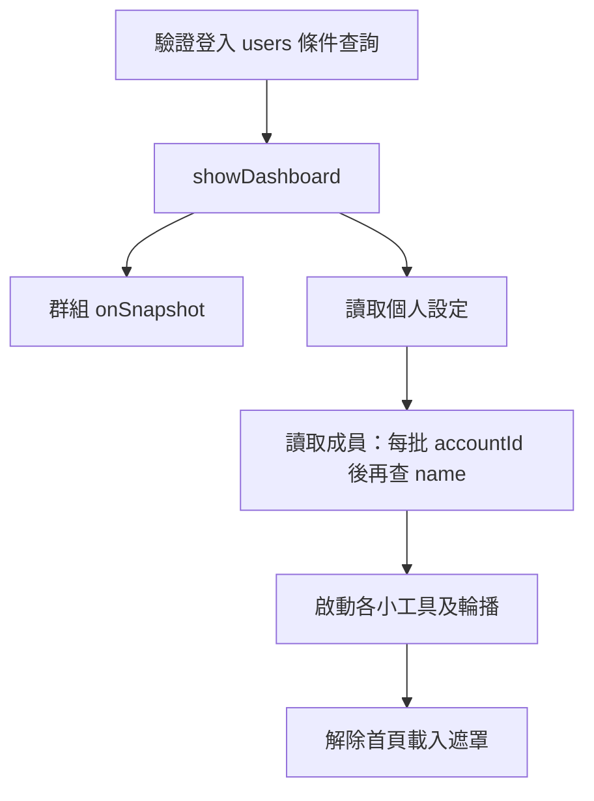
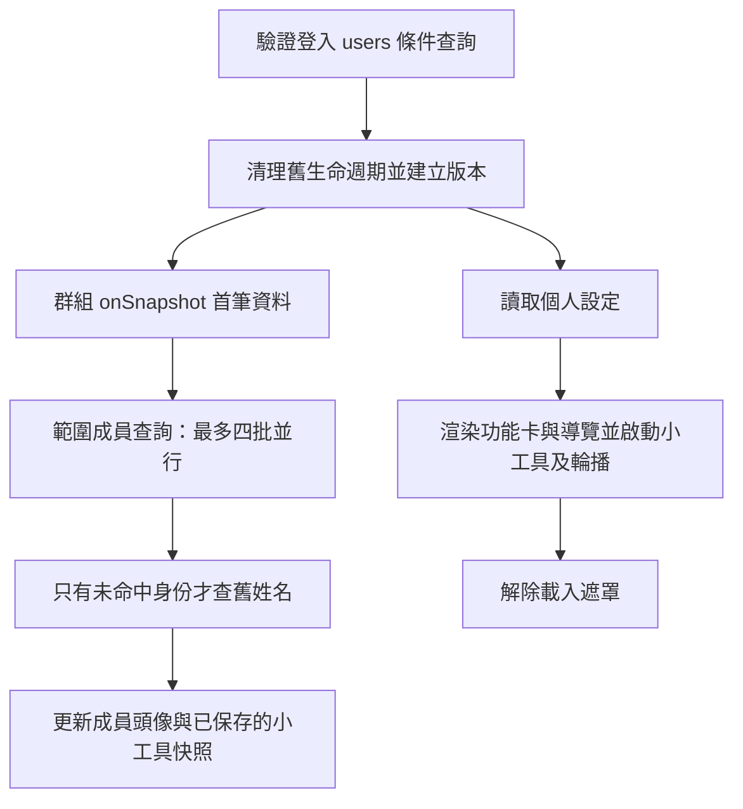
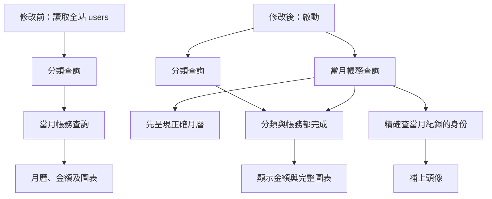

# Nexus 第二階段效能優化與驗證

日期：2026-10-28。修改前基準：`8990aed`。本階段只處理首頁訂閱生命週期與首頁／記帳本初始化；保留原生多頁網站及底部導覽完整換頁方式。未修改 Firebase 結構、Security Rules、RTDB 開關、遊戲或其他模組功能。尚未提交、推送或部署。

## 1. 修改檔案

| 檔案 | 變更 |
|---|---|
| `js/dashboard.js` | 保存及解除輪播訂閱；初始化版本檢查；相關訂閱／Timer 可重入；未讀統計請求去重；重用群組首筆快照；頭像移出首屏等待；以現有快照更新晚到的頭像 |
| `js/main.js` | 首頁成員改用共用精確查詢；拒絕舊群組結果；設定渲染加入版本檢查；離頁清理及 BFCache 返回時恢復 |
| `js/auth.js` | 顯示登入區時呼叫首頁清理，只有一行 |
| `js/expense.js` | 分類與月份查詢平行；按當月紀錄的身份載入頭像；月份版本檢查；未知金額維持載入狀態；等待分類後才顯示完整圓餅圖 |
| `js/scoped-profiles.js` | 新增共用範圍查詢工具：10 筆一批、最多 4 批並行、同時相同請求共用、舊姓名相容、歧義姓名不猜身份 |
| `expense.html` | 初始金額文字由 `$0` 改為「讀取中...」，沒有重新設計 UI |
| `tests/performance-init.cjs` | 真實頁面隔離測試、修改前基準載入、20 次並行初始化／清理、載入指標及功能回歸 |
| `tests/scoped-profiles.test.mjs` | 共用查詢工具 7 項測試 |
| `docs/performance-phase2.md`、`docs/performance-phase2-results.json` | 本報告及三次基準／三次修改後量測與生命週期原始紀錄 |

## 2. 根本原因與修正

### P0：輪播訂閱及非同步初始化的生命週期

`fetchAndRenderPhotoCarousel()` 原本呼叫 `onSnapshot()` 卻未保存回傳的 unsubscribe。`galleryUnsubscribe` 實際負責的是照片未讀統計的 focus／visibility 事件，不能解除輪播訂閱。

此外，兩次 `showDashboard()` 若同時進行，第二次清理可能發生在第一次仍等待設定／成員資料時。舊的初始化恢復後會再掛上聊天、行事曆、待辦、記帳訂閱，以及 Timer、未讀提示事件；此時只有後一次建立的解除函式被保存。

處理方式：

- 輪播有獨立的 `carouselUnsubscribe`，重新建立前及 `stopDashboardListeners()` 都會解除。
- 每次初始化／清理更新 generation。較舊的初始化、設定渲染與群組／成員回應不能再更新新畫面或建立訂閱。
- 未讀提示、行事曆及小工具的建立函式會先解除自身上一份工作；行事曆每次只保留一個 interval。
- 照片未讀統計的 focus／visibility 同時觸發時共用正在進行的統計；已清理的回應不能回寫 badge。
- 晚到的頭像使用現有小工具快照重新呈現，不重新查詢或建立監聽器；清理會釋放快照與重繪閉包。
- 離開首頁或回登入區會清理；由 BFCache 返回可見的首頁時重新初始化。頁面生命週期的 pagehide／pageshow 處理函式只隨文件載入建立一次。

檢查結果：這個首頁模組沒有建立 Observer。輪播原本使用 CSS 水平捲動及 scroll-snap；未找到自動換張 Timer，本次沒有新增或刪除自動換張功能。已驗證原生觸控滑動、按讚／取消讚、照片連結導頁。

### P1：首頁成員查詢擋住其他資料

原本首屏依序等待個人設定、所有成員，再啟動資料小工具。成員每批先查 accountId，再無條件查姓名，即使 accountId 全部命中也照查。若群組快照尚未返回，還可能額外 getDoc 相同群組。

現在：

- 登入帳號驗證仍先完成，沒有使用暫存身份繞過既有檢查。
- 個人設定讀取與既有群組監聽首筆快照平行進行；成員查詢直接使用該群組快照的 members，不再額外讀一次群組文件。
- 設定決定功能卡、排序與導覽，仍是小工具建立的前置依賴；成員頭像則是次要內容，不阻塞首屏或小工具訂閱。
- 只讀 `groups/{groupId}.members` 指定的身份；每批最多 10 個，最多 4 批平行。僅 accountId 未命中的項目才使用舊姓名相容查詢，姓名相容查詢必須等待 accountId 結果。
- 同時相同的成員請求只送一次；完成或失敗即移除共用中的 Promise，沒有長期資料快取造成換群組／改名後資料過期。
- 舊群組資料與金額卡片在切換開始時清除；晚到的舊回應不能覆蓋目前群組。

首頁原本已使用條件式 users 查詢，本次沒有宣稱首頁原本有全站 users 掃描。全站掃描發生在記帳本。

### P1：記帳本先掃所有使用者，再串行讀取分類與月份

原本 `initApp()` 等待 `loadAllUsers()` → `loadCustomCategories()` → `loadMonthData()`。當月金額其實不依賴任何使用者頭像，但仍被全站資料量及前兩次請求延遲拖住。

現在分類與當月帳務各自啟動。月曆取得帳務後先顯示；圓餅圖等分類和帳務都完成才顯示，避免漏掉自訂分類。頭像只按目前群組、目前月份記錄中的 accountId 查詢；只有沒有 accountId 的舊紀錄才以 operator 姓名相容處理。已知 accountId 不會拿同名帳號當替代。

新增月份版本檢查，快速換月時舊請求與舊頭像回應不能覆蓋新月份。請求中清掉上一月份圖表及數字；讀取失敗保留未知狀態，不顯示假 `$0`。資料尚未就緒時不能開啟該日新增表單；既有新增／刪除流程及收入權限條件保持不變。

## 3. 初始化流程與資料依賴

修改前首頁：



修改後首頁：



修改前／後記帳本：



`Promise.all` 使用於互相獨立的查詢批次，以及已知 accountId／舊姓名兩組頭像查詢。批次有失敗時不提交不完整的成員清單，因此沒有使用 allSettled 將失敗批次悄悄視為空結果。分類及月份各自保留錯誤處理，次要頭像失敗不阻塞金額。保留的先後依賴包括身份驗證、功能卡依賴設定、舊姓名依賴 accountId 未命中結果、圖表依賴分類及月份資料。

## 4. 修改前後測量

測試使用本機 Chromium、390×844 觸控 viewport、真實 HTML／ES modules，所有 Firebase SDK 及外部 CDN 路徑均由測試攔截。Firebase 是記憶體 SDK 替身，**不是官方 Emulator，也不是正式環境**。每個資料操作固定等待 60 ms；修改前由 Git `8990aed` 讀取原始檔案，沒有把工作目錄改回舊版本。三次基準與三次修改後依序執行，以避免同時跑瀏覽器干擾數據。

測試資料共 103 位使用者，目前群組 2 人，當月 1 筆 $125 支出，另一群組有 $999 支出，並有 1 個自訂分類、3 張輪播照片。首頁與記帳本都驗證只呈現 $125。

| 從導頁開始量測，三次中位數 | 修改前 | 修改後 | 此測試改善 |
|---|---:|---:|---:|
| 首頁可操作：遮罩消失且 dashboard 顯示 | 505.4 ms | 348.7 ms | 約 31.0% |
| 首頁內容：輪播、兩位成員、正確記帳小工具金額 | 575.5 ms | 417.4 ms | 約 27.5% |
| 記帳本顯示正確當月總額 | 295.8 ms | 119.1 ms | 約 59.7% |

這是模擬延遲下的 UI 就緒指標，不是 LCP、正式 Firebase latency 或 iPhone／Android 真機數據。沒有量測真機 FPS、堆積記憶體、正式計費讀取量，也不能由這些結果承諾正式環境相同百分比。

### Firestore 操作比較

| 固定測試資料的一次初始化 | 修改前 | 修改後 |
|---|---:|---:|
| 首頁 getDoc/getDocs 呼叫 | 4 | 3 |
| 首頁 onSnapshot 建立 | 6 | 6 |
| 首頁未讀照片 count aggregation | 1 | 1 |
| 首頁總操作數（上述三種合計） | 11 | 10 |
| 其中群組成員的 users 查詢 | 2 | 1 |
| 記帳本 getDocs 呼叫總數（包括稍後完成的頭像） | 3 | 3 |
| 記帳本頭像查詢返回的 users 文件 | 103 | 1 |

記帳本總查詢次數在這個小樣本中沒有減少；改進是精確查詢回傳資料量，以及必要資料不再等待頭像。群組或當月涉及的人數較多時，查詢數隨每批 10 人增加。舊姓名相容可能增加查詢。上述是 SDK 呼叫及 fixture 返回文件數，**不等於正式 Firestore 帳單讀取數**；快取、共享監聽、空查詢最低計費與 aggregation 計費皆另有規則。

原始三次樣本、每個初始化操作、回傳數及 20 次生命週期追蹤見 [performance-phase2-results.json](performance-phase2-results.json)。

## 5. 生命週期與功能驗證

每一輪同時啟動兩次 `showDashboard()`，等初始化後再清理，重複 20 輪；修改後三次量測各包含完整 20 輪。

| 第 20 輪 | 修改前基準 | 修改後 |
|---|---:|---:|
| 清理前輪播訂閱 | 41 | 1 |
| 清理後輪播訂閱 | 41 | 0 |
| 清理後聊天／行事曆／待辦／記帳訂閱 | 各 20 | 全部 0 |
| 清理後行事曆 interval | 20 | 0 |
| 清理後未讀提示 focus／visibility 事件註冊 | 40 | 0 |

修改後每輪啟用時均為 1 個輪播訂閱、1 個 interval、2 個未讀提示事件，清理後全為 0。這裡計算的是模組所擁有的 Firebase 訂閱、window/document 事件及 Timer，並非量測瀏覽器全部事件或以堆積快照證明整個 App 不可能有其他記憶體問題。主文件的一次性鍵盤及 pagehide/pageshow 處理函式不應每次 dashboard 清理就移除，且不會逐次增加。

已通過：

- 新測試 `tests/performance-init.cjs`：20 輪同時初始化及清理、初始化中途取消、快速切換群組、慢成員回應不擋首屏、focus／visibility 同時發生只統計一次、pagehide 清理與 BFCache pageshow 恢復、輪播觸控滑動、按讚／取消、照片導頁。
- 同一測試：群組帳務隔離、正確當月總額、個人頭像、自訂分類、快速換月的回應亂序、月份請求失敗不顯示錯誤金額、新增／刪除帳務、分類慢於帳務時等待後才畫完整圖表。
- `tests/scoped-profiles.test.mjs`：7 項；精確查詢、併發請求合併、空群組、缺失群組、55 人批次／最多 4 個 worker、舊姓名相容／重名排除、失敗重試、已知 ID 不猜姓名、頭像別名不覆蓋 ID。
- 既有 `tests/group-switch.cjs`：切換、建立、加入、取消、身份及重複送出防護。
- 既有 `tests/navigation-browser.cjs`：六項導覽、七個功能頁、完整換頁、權限與帳號隔離、遊戲例外。
- 既有 `tests/theme-browser.cjs`：十種主題、儲存失敗重試、跨頁及帳號隔離。
- 既有 navigation/theme 單元測試 5 項，加新測試共 12 項通過；修改 JS 語法及 CRLF 感知 diff 檢查通過。

重跑方式（專案目錄，需已有 Playwright 與 Chromium，不需安裝新應用依賴）：

```bash
python3 -m http.server 8012
```

另一個終端：

```bash
BASELINE=1 node tests/performance-init.cjs
node tests/performance-init.cjs
node --test tests/scoped-profiles.test.mjs tests/navigation.test.mjs tests/theme.test.cjs
node tests/group-switch.cjs
node tests/navigation-browser.cjs
node tests/theme-browser.cjs
```

`BASELINE_REF` 可指定基準 Git revision；預設 `8990aed`。`PERF_OUTPUT` 可指定 JSON 輸出，預設寫入 `/tmp`。基準模式只記錄舊行為，不會要求舊版本通過修正後的生命週期斷言。

## 6. 權限、索引與修改風險

- `users.accountId in [...]` 與 `users.name in [...]` 為單欄位條件，沒有引入新的複合索引需求；仍需現有單欄位索引可用。本次未建立、修改或部署索引。
- 現有 expenses 的 `groupId ==` 加 `date >= / <=`、photos 的 `groupId ==` 加 `timestamp desc`，以及首頁其他查詢條件均未變更。現有索引需求保留；無正式環境索引清單，不能宣稱已在正式後端驗證。
- 不改 Security Rules、不啟用 RTDB。群組成員依群組 members，帳務及分類保持 groupId 條件；舊姓名歧義時不選任意帳號。
- 主要風險是非同步順序改變；使用 generation／月份版本、清除舊資料、晚到回應丟棄、慢請求與亂序回歸降低風險。
- 舊資料若只有姓名且全站重名，現在可能只能顯示文字備援而無頭像；這是避免顯示錯誤身份的保守處理，未改寫任何舊資料。
- 真機瀏覽器、正式 Firestore 權限／索引、線上長時間記憶體及帳單改善仍須部署後量測。沒有進行正式部署或生產資料操作。

## 7. 本階段未處理

前次診斷的相簿全量查詢／重建、Phaser 預載與圖形繪製、雞 Sprite 重建、商店／倉庫 scene shutdown 事件、公開村落查詢、歷史資料讀取、聊天室列表重建、其他模組 BFCache 行為與 CSS／圖片大小等問題保持原狀。

登入／註冊為了舊帳號大小寫相容而使用的 `account-identity.js` 全站掃描，與記帳本歷史回顧全群組帳務查詢，也未在本次修改。沒有將 MPA 改為 SPA，也未變更底部導覽的換頁方式。
