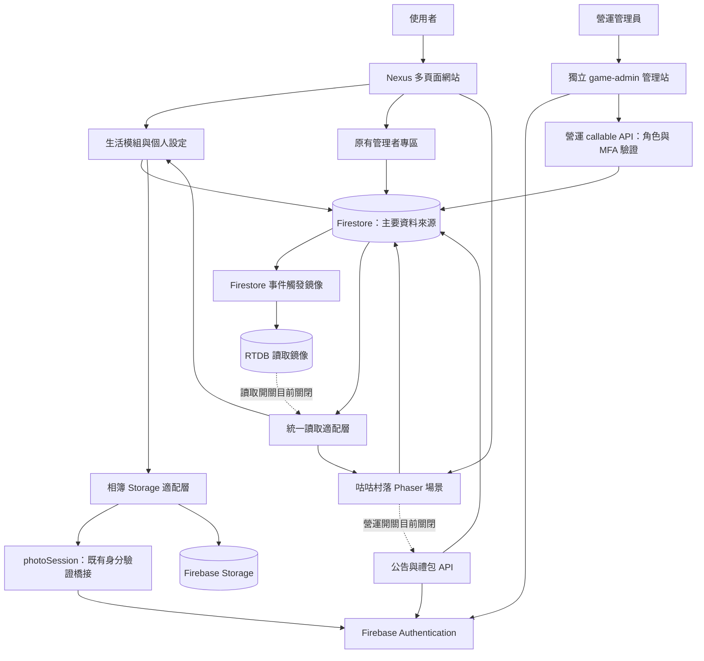
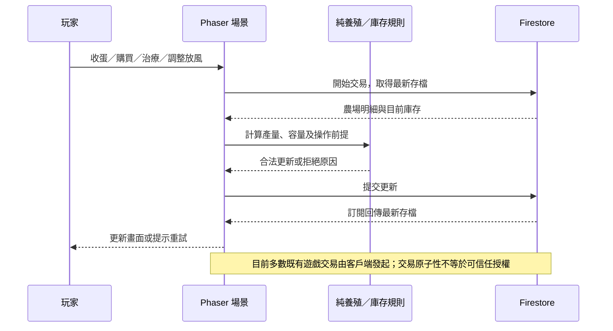
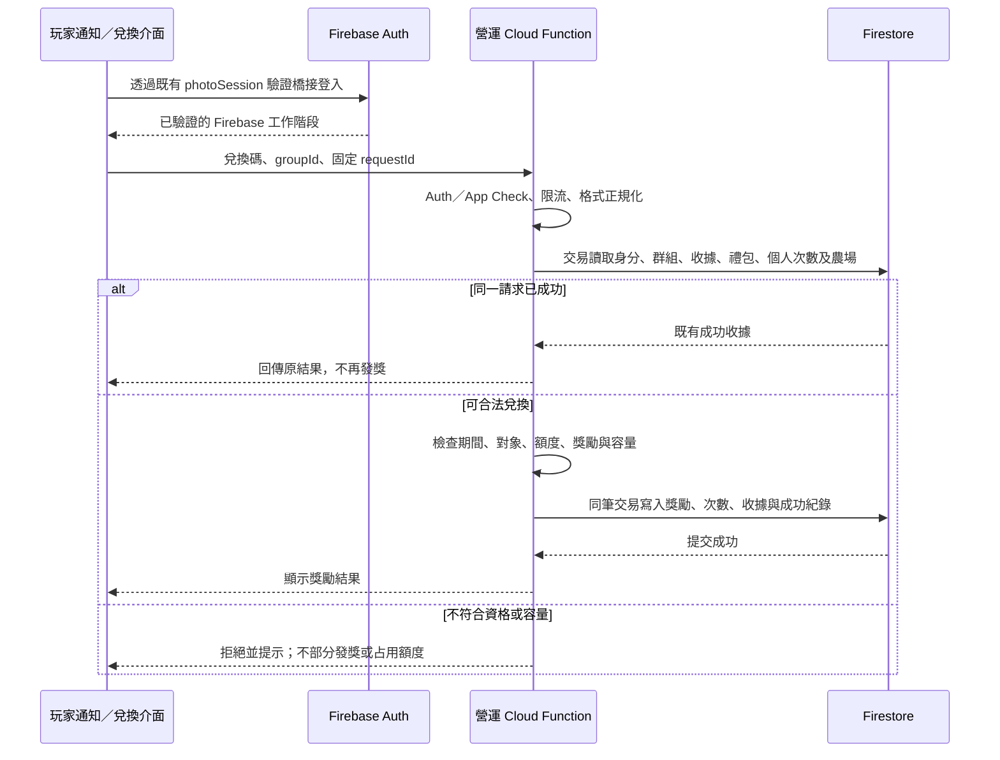

# Nexus 與咕咕村落：系統規格與架構文件

> 文件版本：1.0  
> 整理日期：2026-11-04（Asia/Taipei）  
> 程式基準：`duncanyen/kids-checkin`，提交 `3aa13d1b5354f042ada31a970192e7eb0c69297c`。  
> 用途：產品理解、開發交接、維運與架構決策留存。

本文依儲存庫程式及既有模組文件整理。**「程式已實作」「開關已啟用」「正式環境已部署」「正式環境已驗證」是不同狀態**，不能相互替代。本文未重新讀取正式 Firebase 主控台、資料、IAM 或實際部署版本；正式環境須另行核對。

## 閱讀導覽

- 非技術人員：先讀第 1、3、5 章，了解產品、遊戲規則與目前限制。
- 開發者：續讀第 2、4、6、7 章，掌握程式入口、資料識別、測試與交付步驟。
- 維運／專案擁有者：優先確認第 1.3、5.1、6.3 章的安全與部署條件。

---

## 1. 系統概述（System Overview）

### 1.1 解決的問題

Nexus 是以家庭／群組為協作單位的生活整合網站，將溝通、共同安排與生活紀錄集中在同一個入口，減少資料分散在聊天、紙本與不同工具的情況。

咕咕村落是 Nexus 遊戲大廳中的多人養殖遊戲，透過養雞、收蛋、交易、村落拜訪及防守挑戰增加互動。它與 Nexus 共用帳號及群組背景，但每個帳號在不同群組的農場分開保存。

### 1.2 核心目標與功能

| 目標 | 主要能力 |
| --- | --- |
| 集中日常協作 | 聊天室、行事曆、待辦、相簿、記帳本、到家打卡、許願牆、餐食決策 |
| 支援多群組 | 群組切換、入群申請、邀請、成員管理及功能開放設定 |
| 保持身分穩定 | 以 accountId 連結資料，更名不應改變資料歸屬 |
| 提供遊戲互動 | 多品種雞隻、產蛋、倉庫、武器、怪物、偷蛋、護衛犬、通知與排行榜 |
| 方便行動裝置使用 | 響應式頁面、個人主題／字級、iPhone 加入主畫面 |
| 支援後續營運 | 獨立遊戲管理站、公告與禮包 API、兌換紀錄與後端稽核（目前未啟用） |

### 1.3 目前實作與啟用狀態

| 範圍 | 儲存庫狀態 | 解讀方式 |
| --- | --- | --- |
| Nexus 主站與咕咕村落 | 已實作，主要以 Firestore 存取 | 正式站是否已更新至此版本，仍需核對部署 |
| Nexus 管理者專區 `admin.html` | 已實作 | 沿用既有玩家角色／群組管理流程 |
| 日本長尾雞 | 商店展示，`purchasable: false` | 買價設定存在，但目前不允許購買 |
| RTDB 高頻讀取 | 鏡像與讀取適配層已實作 | `REALTIME_READS_ENABLED = false`，前端目前仍以 Firestore 為主 |
| 獨立遊戲營運後台 `game-admin/` | 已實作主要程式 | 正式部署、實際 MFA 及必要 Emulator 驗證尚未完成 |
| 新營運公告與禮包兌換 | 管理 API 與玩家整合已實作 | `GAME_OPERATIONS_ENABLED = false`，尚未啟用 |

### 1.4 使用者與管理角色

| 身分 | 使用入口與職責 | 權限來源 |
| --- | --- | --- |
| Nexus 一般成員 | 使用獲授權的生活模組、遊戲及個人設定 | 既有 users 角色、menus、群組成員與遊戲權限 |
| Nexus 管理者／家長 | 入群審核、成員、功能與遊戲開放、群組設定及操作紀錄 | 既有管理者專區的身分與群組檢查 |
| 遊戲營運管理員 | 獨立管理站內的公告、禮包、兌換追蹤及稽核 | Firebase Auth Custom Claim `role: admin`、MFA 及後端當前角色檢查 |
| Firebase 專案擁有者 | 建立首位管理員、IAM、驗證服務、部署、規則及索引 | Google Cloud／Firebase 專案權限 |

**上述管理身分不可互相推定。** users 文件中的管理角色，不等於 Firebase Auth 的營運管理員 Claim；Firebase 專案的 IAM 身分也不等於網頁中的遊戲管理角色。

---

## 2. 系統架構設計（System Architecture）

### 2.1 技術選型與技術堆疊

| 層次 | 技術／設計 | 用途 |
| --- | --- | --- |
| 玩家前端 | HTML、CSS、原生 JavaScript ES Modules，多頁面架構 | 各生活模組與管理者專區，沒有統一 SPA 框架 |
| 遊戲引擎 | Phaser 3.60.0 | 場景、精靈動畫、互動、戰鬥、鏡頭及素材載入 |
| 共用介面 | CSS 主題變數、SVG 圖示、導覽與個人版面元件 | 統一外觀、字級及功能開放顯示 |
| 圖表 | Chart.js，按需求載入 | 記帳與統計圖表；版本以實際載入設定為準 |
| Firebase Web SDK | 目前核心模組引用 12.19.0 | Firestore、Auth、Storage、Functions 及 RTDB |
| 主要資料庫 | Cloud Firestore | 群組、生活資料、遊戲存檔、營運設定及交易紀錄 |
| 即時資料庫 | Firebase Realtime Database | 遊戲／聊天室的可選高頻讀取鏡像 |
| 圖片檔案 | Firebase Storage；舊資料亦有內嵌／外部網址 | 新版相簿圖片，保留舊格式相容 |
| 可信任後端 | Cloud Functions v2、Firebase Admin SDK、Node.js 22 | 玩家身分橋接、鏡像、新營運管理及兌換 |
| 行動入口 | Web App Manifest、Apple 主畫面宣告 | 主畫面啟動模式；不是原生 iOS App |
| 測試 | Node Test Runner、Playwright／Chromium、Firebase Emulator 測試程式 | 純邏輯、瀏覽器流程、規則與交易整合 |

Firebase 專案設定為 `homebasedb`，主要 Functions 區域為 `asia-southeast1`。網頁中的 Firebase API Key 是公開連線設定，不是 Admin SDK 憑證，也不能取代安全規則。

### 2.2 主要元件與互動



圖中主站直達 Firestore 的連線代表目前既有設計，**不表示這些操作已全部具備可信任後端驗證**。新營運 API 的安全設計與舊流程的安全程度，必須分開評估。

### 2.3 程式碼與部署邊界

| 位置 | 職責 |
| --- | --- |
| 根目錄 `*.html` | 玩家與原有管理頁入口，例如 index、chat、expense、farmgame、admin |
| `js/`、`css/` | 生活模組、共用資料識別／介面與樣式 |
| `js/farm/` | 遊戲場景、純規則、資料交易、載入及 UI 元件 |
| `assets/farm/` | 遊戲貼圖、透明精靈圖及 Atlas 中繼資料 |
| `functions/` | 既有 `nexus-live` codebase：登入橋接及 Firestore→RTDB 鏡像 |
| `game-admin/site/` | 獨立管理登入與 Dashboard；不共用玩家登入畫面 |
| `game-admin/functions/` | 獨立 `nexus-ops` codebase：營運管理、公告與兌換 |
| `game-admin/rules/` | 新集合規則片段、索引與測試用規則；不可直接覆蓋正式規則 |
| `scripts/` | 素材 Atlas、資料遷移／檢查、後端遊戲模型打包與管理 Claim 工具 |
| `tests/`、`game-admin/tests/` | 玩家與營運後台測試 |
| `docs/` | 功能規格、相容策略、效能與交接紀錄 |

根目錄 `firebase.json` 設定既有 Functions、RTDB／Storage 規則與 Firestore 索引，**沒有宣告玩家網站的 Hosting 配置**。不能僅從 GitHub 已推送推定網站已部署。

管理站另有 `game-admin/firebase.json`，Hosting target 為 `nexus-game-admin`。必須綁定獨立站台，不能覆蓋玩家站的既有部署。

### 2.4 遊戲場景與責任分工

| 元件 | 職責 |
| --- | --- |
| Entry／BootScene | 載入引擎、確認成員與存檔、準備核心素材；錯誤可重試 |
| LobbyScene | 村落入口、可拜訪村落與遊戲導覽 |
| MyFarmScene | 自家養殖畫面、收蛋、清理、病雞治療與防守挑戰 |
| VisitScene | 拜訪畫面、偷蛋、目標農場顯示與訪客挑戰 |
| ShopScene | 買賣、雞舍／倉庫擴充及圖鑑 |
| WarehouseScene | 庫存、武器裝備、餵食、護衛犬及各雞種放風設定 |
| FarmAssetScene | 共用素材佇列、延遲載入、下載失敗及動畫註冊 |
| 純規則模組 | 養殖、庫存、戰鬥、放風、排名等不依賴畫面呈現的計算 |
| Store／交易模組 | 讀取最新資料、檢查前提、更新存檔及處理冪等結算 |

---

## 3. 核心模組說明（Core Modules）

### 3.1 Nexus 生活平台

| 模組 | 使用者能力 | 運作重點 |
| --- | --- | --- |
| 帳號與群組 | 登入、註冊、選群組、加入與管理成員 | 新帳號正規化；accountId 為穩定識別；group.members 為成員關係依據 |
| 首頁與個人設定 | 模組卡片、導覽排序、主題、字級、頭像 | userSettings 以 accountId 保存，受功能開放清單約束 |
| 聊天室 | 建立房間、成員、文字／圖片、回覆、已讀、歷史、匯出 | 房間與訊息使用穩定帳號欄位；新訊息監聽與歷史分頁合併 |
| 行事曆 | 日期導覽、群組／個人事件、建立及編輯 | events 保存資料；日期／可見範圍與人員欄位以目前模組實作為準 |
| 待辦 | 分類、指派、循環任務、完成紀錄 | 群組文件保存；以帳號指派；循環任務由頁面載入／定時檢查補齊 |
| 記帳本 | 收支、分類、月度清單、分頁、日曆及統計 | expenses 依群組／日期查詢；彙總查詢與清單分頁分開；新增不自動聚焦金額 |
| Photo Dump 相簿 | 多圖上傳、瀏覽、分頁、留言與圖片互動 | 新圖經壓縮上傳 Storage，再保存照片資料；支援部分失敗清理 |
| 許願牆 | 成績／家事積分、獎品與兌換 | 群組內保存規則與紀錄；交易與版本文件避免使用過期積分 |
| 吃什麼 | 餐廳、篩選、輪盤、投票與用餐決定 | groupId＋日期＋餐別形成固定文件；票以 accountId 為 key |
| 到家打卡 | 到家時間、歷史及聊天室通知 | 保留舊 checkins／settings／messages 流程；存在舊姓名與共用設定依賴 |
| 遊戲大廳 | 咕咕村落、猜拳、2048 與排行 | game_permissions 控制功能開放；不同遊戲的紀錄集合分開 |
| 原有管理者專區 | 群組、入群審核、成員、遊戲權限及日誌 | 多群組關係以 members 為準；介面圖示已採 SVG；舊日誌不是防竄改稽核 |

### 3.2 聊天歷史規則

- 初始讀取最新 30 則，使用者可繼續載入更早訊息，每頁 30 則。
- 不以一天或 30 天作為前端歷史截止條件；仍存在資料庫的舊訊息可以繼續查看。
- 歷史與即時結果依文件 ID 合併去重，避免新訊息覆蓋已載入頁面。
- 使用文件游標處理同時間戳排序，載入舊訊息維持閱讀位置。
- 匯出與相簿檢視使用目前已載入清單，不等於自動匯出整個房間所有歷史。
- 原始碼未發現一天刪除排程；正式 Console 中的 TTL 或外部清理工作未經查核。

### 3.3 咕咕村落養殖與經濟規則

| 雞種 | 買進金幣 | 賣出金幣 | 產蛋間隔 | 每隻未收蛋上限 | 每顆蛋售價 | 目前狀態 |
| --- | ---: | ---: | --- | ---: | ---: | --- |
| 母雞 | 1,000 | 500 | 4 小時 | 6 顆 | 10 | 可購買 |
| 烏骨雞 | 2,000 | 1,000 | 4 小時 | 6 顆 | 30 | 可購買 |
| 布雷斯雞 | 4,000 | 2,000 | 6 小時 | 4 顆 | 80 | 可購買 |
| 日本長尾雞 | 6,000 | 3,000 | 6 小時 | 4 顆 | 120 | 商店展示、禁止購買 |

「24 小時產量」同時用作目前模型的未收蛋容量上限，並不是每天午夜把所有狀態重設。滿產會暫停計時，收蛋釋出容量後再恢復，避免無限追補離線時間。

其他主要規則：

- 雞舍 Lv.1／2／3 以上共用容量分別為 3／10／20 隻；所有品種共同占用，不是每品種各有一份容量。
- 生產依每隻雞的品種、laidAt、疾病與滿產狀態計算，並保留各品種蛋的數量。
- 收蛋依倉庫剩餘空間部分收入，放不下的蛋留在雞舍；活雞不占一般物品倉庫容量。
- 菜蟲、蚯蚓可對選定品種的健康雞加速 30／60 分鐘；不適用時不消耗。
- 生病停止產蛋；治療消耗 medicines，從治療時間重新計時。超過既有 48 小時疾病期限會移除雞隻。
- 放風僅影響畫面精靈：6 隻以下全部放出；超過 6 隻時可依品種調整，但合計至少 6 隻。雞舍內外都依完整飼養數計算產能。
- 放風入口在倉庫「雞」分類的雞隻項目，使用商店式「－／數量／＋／MAX／確認／取消」面板；最低數在確認時驗證。
- 有病雞時，主人點雞舍可選清理或「餵食咕咕活力飲」。該操作沿用 medicines（現有商品名稱為咕咕活力散），每次隨機治療一隻；外面病雞仍可直接點選。
- 已產的蛋不因售出最後一隻雞而消失；空雞舍不會自動贈送新母雞。

### 3.4 村落拜訪、護衛與戰鬥

- 村落分公開／封閉，拜訪與跨群組操作需確認雙方的群組／成員／村落條件。
- 偷蛋作用於目標現有的蛋，收入操作玩家目前群組的農場庫存；沿用冷卻與成功率，護衛犬可能攔截並延長限制。
- 護衛犬是租用品，依品種有不同租金、攔截率與封鎖時間，啟用狀態與到期時間獨立管理。
- 怪物包括狼、虎、烈火龍、大金剛、巨飛鷹、蛇王與地鼠；傷害依武器與怪物配置，飛行怪物需弓箭。
- 雞舍 Lv.2 起，成功抓到菜蟲＋蚯蚓累計每 **30 隻**取得一次地鼠觸發門檻；賣掉／餵掉蟲子不倒扣累計，沒有收穫的點擊不計次。
- 地鼠避開其他怪物；準備、戰鬥與結算期間停止抓蟲。一次三隻、共用血量，在菜園 12 個邏輯位置間移動，但不畫格線。
- 地鼠限時 60 秒；木棒／狼牙棒／雙手斧／大鐵槌累計需 300／200／150／100 下。整場勝利獲得地瓜一個，可售 300 金幣；逾時扣挑戰者最多 100 金幣，不扣鄰居資產。
- 部分挑戰有持久化期限、門檻及結果 ID，重送結算不重複掉落；不同怪物的恢復能力仍有差異，不可視為統一的伺服器戰鬥系統。

### 3.5 通知與營運後台

既有通知包括歡迎禮、匿名訪客紀錄與本機可見的未讀狀態；歡迎禮收據獨立於可刪除通知，刪信不會再寄一份。這條舊發獎流程仍是客戶端 Firestore 交易。

新營運後台另行提供：

| 能力 | 設計 |
| --- | --- |
| 管理登入 | Firebase Auth 電子郵件登入、Custom Claims、TOTP MFA；無預設 admin/admin |
| Dashboard | 從伺服器統計玩家文件、公告、有效公告、禮包、有效禮包與成功兌換，並顯示最近操作 |
| 公告 | 草稿、排程、發布、下架、類型／狀態篩選、前綴搜尋、預覽、分頁、指定帳號及 popup |
| 禮包 | 通用、限量、單次、指定玩家；安全隨機碼或自訂活動碼；僅保存雜湊 |
| 發獎 | 支援金幣、既有各品種蛋、母雞及道具白名單；其他雞種等未開放獎勵明確停用 |
| 紀錄 | 兌換成功／失敗、原因、獎勵明細及後端管理操作前後內容 |

新公告以純文字顯示以避免 XSS；指定公告由後端篩選，不讓一般客戶端直接讀整個集合。排程有效性由伺服器時間判斷；不依賴瀏覽器把 scheduled 改寫成 published。

目前這套新營運能力保留關閉，必須先完成正式權限與部署條件。

---

## 4. 資料流與狀態管理（Data Flow & State）

### 4.1 身分與資料識別原則

| 識別 | 意義 | 注意事項 |
| --- | --- | --- |
| Firestore users 文件 ID | 使用者文件的實際位置，舊資料可能為隨機 ID | 不一定等於 accountId；Firebase Auth 橋接會使用對應文件 ID 作 UID |
| accountId | 穩定登入／資料歸屬識別 | 不以暱稱作主要連結；新帳號正規化，舊混合大小寫 ID 不直接搬移 |
| name／operator | 顯示名稱或歷史快照 | 可以更名、同名，不能單獨作跨群組授權依據 |
| groupId | 目前選定的群組 | 優先取 lastGroupId；users.groupId 可能是舊值，不是完整成員關係 |
| groups.members | 該群組實際的 accountId 清單 | 核心群組功能以此驗證資格 |
| Auth UID／Custom Claims | 可信任後端／規則可驗證的身分與授權 | 不同於 localStorage 裡的使用者資料 |

### 4.2 關鍵 Firestore 資料模型

下列為概念模型與重要欄位，不是完整、已強制執行的資料庫 Schema。

| 路徑／集合 | 主要內容與注意事項 |
| --- | --- |
| users/{profileId} | accountId、name、role、menus、avatar、nameHistory，以及舊 password／pin；不得在文件、前端紀錄或交接附件輸出實際值 |
| groups/{groupId} | name、members、村落公開狀態等群組設定 |
| group_requests、system_menus | 入群申請與功能開放選單 |
| userSettings/{accountId} | 個人導覽、排序、顯示與外觀；相容可確認歸屬的舊姓名文件 |
| rooms/{roomId} | groupId、participantIds、creatorAccountId、最後訊息、已讀及未讀；仍需相容舊姓名成員欄位 |
| messages/{messageId} | roomId、groupId、senderAccountId、sender、text、imageUrl、timestamp、replyTo、收回狀態等；舊訊息可能缺新識別欄位 |
| events/{eventId} | 行事曆事件、日期、可見範圍及人員資訊 |
| todos/{groupId} | categories、todos、recurringTemplates、指派與完成資訊；目前為群組聚合文件 |
| expenses/{expenseId}、customCategories | 群組收支、金額、日期、類型、accountId／operator、分類 |
| photos/{photoId} | 圖片網址／Storage 路徑、建立者、群組、內容及互動資訊 |
| food_restaurants、food_votes/{固定ID} | 群組餐廳；groupId＋日期＋餐別的每日投票與 decision |
| groups/{groupId}/settings/wishWall | 許願牆共用規則與獎品 |
| groups/{groupId}/scores、redeems、messages | 許願積分、兌換及通知；與頂層聊天／遊戲同名集合並非相同業務 |
| game_permissions、game_records、game_records_2048 | 遊戲開放、猜拳與 2048 紀錄；文件識別需依各遊戲相容邏輯確認 |
| checkins、settings/checkinConfig | 原有打卡與通知目標設定；含舊共用設定，不應假設已全部按群組切分 |
| logs、app_notifications | 舊操作足跡及 App 通知；與營運後台稽核分開 |
| groups/{groupId}/users/{accountId} | 群組內玩家資料，內含 farm；不是頂層 users 的替代品 |
| 該玩家文件下 farm_notifications、farm_meta | 農場通知、建檔收據等子集合 |

### 4.3 農場存檔模型

| 欄位群組 | 說明 |
| --- | --- |
| coins、coopLevel、warehouseLimit | 金幣、雞舍等級、一般物品容量 |
| hens、hensState | 總隻數及逐隻狀態：id、breed、laidAt、isSick、sickTimestamp、pausedFull |
| poultryVersion、readyEggs、eggsReady | 養殖版本、各品種未收蛋及總未收蛋；摘要必須與明細一致 |
| inventoryEggs、silkieEggs、bresseEggs、onagadoriEggs | 已收入倉庫的各類蛋，與雞舍內 readyEggs 分開 |
| medicines、worms、earthworms、各武器／掉落品欄位 | 治療、餵食、裝備、販賣等庫存；以明確 inventory 白名單計算容量 |
| equippedWeapon、equippedBow | 目前近戰／弓裝備；需仍擁有對應庫存 |
| outdoorHensByBreed | 每品種放風數量；不改變 hens 或完整產蛋狀態 |
| gardenCatchCount、moleLastMilestone、moleChallenge／Results | 地鼠抓蟲累計、已使用門檻、持久化期限及結果收據 |
| combatKills、cobraLastMilestone、cobraChallenge／Results | 擊殺進度與蛇王挑戰／結算相關狀態 |
| 其他遭遇結果、護衛犬租約及偷蛋冷卻 | 各對應模組管理，避免覆寫其他群組或他人狀態 |

重要不變條件：不能因查不到快取而建立一份預設農場覆蓋原存檔；不能只改 hens 或 eggsReady 摘要而漏掉 hensState／readyEggs；不能把未放風的雞當成不存在。

### 4.4 新營運集合

| 集合 | 職責 |
| --- | --- |
| ops_announcements | title、content、type、priority、targetType／帳號清單、startAt／endAt、showPopup、status、建立與更新資訊 |
| ops_gifts | 名稱、說明、type、codeHash、rewards、全服／每人限制、redeemedCount、指定對象、時間與狀態 |
| ops_gifts/{id}/claims | 以帳號為範圍的個人兌換次數，不因切換群組重置 |
| ops_code_index | 正規化碼的 SHA-256 雜湊對應禮包 ID，建立時檢查唯一 |
| ops_receipts | UID＋requestId 的冪等收據，綁定碼雜湊與群組 |
| ops_redemptions | 玩家、時間、結果、獎勵與失敗原因 |
| ops_audit | 後端管理操作、UID、對象、前後內容及結果；不記完整碼、密碼或 token |
| ops_admin_requests | 管理寫入請求的重送識別與回應資訊 |
| ops_limits | 使用者／IP 雜湊的速率限制桶 |

### 4.5 一般生活功能資料流

1. 從既有登入狀態取得 accountId 與目前群組。
2. 適用模組驗證最新成員資料後，查詢該群組的文件或啟動訂閱。
3. 使用者編輯時先做介面驗證；需要並行保護的寫入在 transaction 重新讀最新資料。
4. 成功後由訂閱或重新查詢更新畫面；失敗保留可重試的表單狀態。
5. 切換日期、房間、群組或離開頁面時解除訂閱，並使用版本／token 檢查丟棄舊請求。

此流程並非所有舊頁面已完全一致。打卡、舊遊戲紀錄與舊通知等仍有歷史格式，需要個別盤點。

### 4.6 遊戲產蛋與交易資料流



產蛋以時間差結算並設離線上限，不是伺服器每隔幾小時替每隻雞寫一次資料。畫面開啟時亦會有計時檢查；關閉頁面後仍可在下次操作補算合理範圍的產量。

### 4.7 新禮包兌換資料流（啟用後）



獎勵只寫 Firestore，RTDB 沿用既有鏡像更新。**不存在 Firestore 與 RTDB 的單一跨庫交易**，也不在兩處各建立一份可領獎勵。

### 4.8 狀態管理與快取

| 狀態層 | 範例與責任 |
| --- | --- |
| sessionStorage／localStorage | 舊登入資料、lastGroupId、外觀／排序、公告已讀、待完成兌換 requestId；不得視為可信任授權 |
| 一般頁面記憶體 | 當前房間、月份、分頁游標、表單、讀取版本、忙碌旗標 |
| Phaser Scene／Registry | myFarmData、farmLoadState、場景生命週期、素材狀態與互動鎖 |
| Firestore | 主要持久狀態與交易結果；快取快照與伺服器確認不能混為一談 |
| RTDB | 版本化讀取鏡像；未 ready 時依適配層策略處理，不代表另一份資料主權 |
| Auth | 各獨立 Firebase App 的工作階段；照片／即時讀取／營運避免混用驗證狀態 |

沒有 Vuex、Redux 或統一的全域狀態框架；跨頁主要依持久識別、共用模組與重新讀取維持一致。

### 4.9 時間與日期

- 新營運公告與禮包時間使用 UTC Unix 毫秒保存，管理介面採 Asia/Taipei 輸入／顯示，伺服器判斷有效性。
- 既有生活模組混用 Firestore Timestamp、毫秒、ISO 字串及 YYYY-MM-DD 等日期鍵；交接時不可整批假定為單一格式。
- 遊戲部分時間仍以客戶端 Date.now 計算，存在時鐘被調整的風險。
- 不同頁面的日期鍵不一定全部已強制台灣時區；日期轉換需依模組規則與測試處理。

---

## 5. 未來擴展與已知限制（Known Issues & Future Scope）

### 5.1 優先處理的風險與限制

| 項目 | 目前狀態／影響 | 建議方向 |
| --- | --- | --- |
| 玩家驗證仍有舊制 | users 含 password／pin，部分登入與寫入由前端處理，工作階段可能保存舊驗證資料 | 規劃遷移至完整 Firebase Auth；限制敏感欄位可讀性，不再讓瀏覽器接觸其他人的憑證 |
| 遊戲經濟信任邊界 | 多數金幣、買賣、治療、歡迎禮及戰鬥結果由前端交易處理 | 將資產變動遷移到可信任後端；伺服器計算價格、資格與獎勵，並同步收緊規則 |
| 正式 Firestore 規則缺版本 | 儲存庫只有索引與新規則片段／測試規則，不能確認正式 allow 範圍 | 取得正式規則並版本化；測試正常流程與越權流程後才能部署 |
| 規則片段不能覆蓋寬鬆 allow | Firestore 多條匹配的 allow 以 OR 合併 | 新增 deny 不足以補救既有 allow-all，須審查整份正式規則 |
| 獨立營運後台未正式完成啟用 | 部署認證、MFA、App Check、Hosting／規則與 Emulator 驗證待完成 | 依 game-admin/README.md 逐項完成，再啟用玩家開關 |
| RTDB 遷移尚未啟用 | 鏡像、回填與切換能力存在，開關仍 false | 先完成部署、回填、版本一致性、權限與失敗情境驗證，不直接開開關 |
| 舊 Schema 與群組隔離不一致 | 姓名欄位、隨機文件 ID、共用打卡設定及多種歷史格式並存 | 逐模組建立遷移清單；以穩定帳號及真正群組關係收斂，不直接重寫整批 ID |
| 聚合文件大小／競爭 | 待辦、逐隻養殖狀態、部分遊戲結果放在同一文件 | 擴大規模前評估 Firestore 文件大小、寫入頻率與交易競爭；必要時拆子集合 |
| 讀取成本與查詢效能 | 部分帳號查重仍掃描 users；歷史頁面與新模組有不同分頁策略 | 使用固定唯一鍵／索引，建立成本與查詢量監控，避免全集合掃描 |
| 時間與戰鬥可被前端影響 | 部分遊戲計時、隨機結果及血量在瀏覽器 | 伺服器管理權威時間與遭遇狀態，必要時驗證命中／結算進度 |
| 背景作業有限 | 循環待辦由頁面驅動；部分產量在下次操作補算 | 若需要無人在線時準時執行，增加可信任排程與可重試工作 |
| 圖片與文件非單一交易 | Storage 檔案與 Firestore 貼文分開提交 | 保留失敗補償；新增孤立檔案檢查與清理作業 |
| 紀錄可信度不同 | 舊 logs 可由前端寫入；ops_audit 為新後端紀錄 | 安全稽核不可依賴舊日誌；建立適當存取、保留及備份政策 |
| 外部 CDN 與網路依賴 | SDK、Phaser 等下載受供應商與網路政策影響 | 評估固定版本自行託管／打包、快取策略與載入監控 |
| 行動 App 模式不是離線應用 | 有 manifest／Apple 宣告，未新增 Service Worker | 不承諾離線交易、推播或背景同步；如需新增須另設快取與資料一致性策略 |

### 5.2 已保留的擴充能力

| 擴充方向 | 現有接點 | 實作時應一併確認 |
| --- | --- | --- |
| 更多雞種 | BREEDS、Atlas、動畫、蛋欄位與庫存白名單 | 價格、產量、存檔驗證、收蛋／死亡／偷蛋、圖鑑與畫面空間 |
| 更多物品與武器 | inventory、combat-rules、Shop／Warehouse、獎勵白名單 | 容量、裝備合法性、各怪物傷害與營運發獎支援 |
| 更多怪物 | 共用 BossEncounter、純戰鬥規則、交易結算 Store | 互斥、期限、重入、場景清理與冪等性；不可只新增動畫 |
| 更大雞群 | 放風數與總飼養數已分離 | 養殖容量、單文件大小、資料結算成本與大量精靈效能 |
| 營運活動／玩家管理 | 獨立管理站導覽與 action handler 架構 | 真正後端權限、資料合法性、操作稽核及批次任務恢復 |
| 推播 | 公告 showPopup 與類型、既有遊戲通知路由 | FCM／APNs 授權、裝置 token、使用者同意與退訂；目前不等於已支援原生推播 |
| 多語與更多主題 | 共用文字／設定及 CSS 變數、SVG 元件 | 現有文字多寫在模組內，仍需抽取字串資源 |

### 5.3 建議演進順序

1. **建立可信任身分與權限基線**：取得正式規則、盤點敏感欄位，逐步完成玩家 Auth 遷移。
2. **遷移經濟寫入**：先處理金幣、物品、歡迎禮、買賣與戰鬥獎勵，避免新後台安全、舊入口仍可任意改資產。
3. **完成隔離驗證及營運啟用**：補跑 Emulator，確認真正 MFA、App Check 與獨立 Hosting，才啟用新公告及兌換。
4. **再做規模擴展**：評估子集合拆分、排程、讀取鏡像、索引、資產打包及成本監控。

---

## 6. 維運、測試與交接程序

### 6.1 開發啟動

玩家站為靜態網站，不需要前端編譯流程；需使用 HTTP 伺服器載入 ES Modules，不能直接雙擊 HTML 當作完整執行方式。開發環境使用既有 checkout。

```sh
cd /workspace/kids-checkin
npm --prefix functions ci
node scripts/prepare-game-admin.cjs
npm --prefix game-admin/functions ci
python3 -m http.server 8030 --bind 127.0.0.1
```

管理登入程式路徑為 `game-admin/site/login.html`，首頁為 `game-admin/site/index.html`。路徑存在不代表已產生正式公開網址。管理員由專案擁有者在可信任環境建立 Auth 帳號，再使用 `scripts/set-game-admin-claim.cjs` 授權，不能由一般玩家自行註冊或從瀏覽器授權。

### 6.2 測試策略與證據範圍

| 類型 | 保護的範圍 | 不能代表的事情 |
| --- | --- | --- |
| 純邏輯／Node 測試 | 養殖、價格、容量、資料識別、分頁、門檻與結算規則 | 正式 IAM／規則或實際網路已正確 |
| Playwright 隔離流程 | 真實頁面、Phaser、桌面／手機版面、失敗重試與資料操作 | 替身 Auth 不等於真實 MFA；手機模擬不等於 iPhone 實機 |
| Emulator 整合 | 真實 Firestore 並發、Auth、Rules 及交易語意 | 正式配置／索引／App Check 已完成 |
| 人工驗收與正式檢查 | TOTP、iPhone 主畫面、Hosting／CDN、權限及觀測 | 不可由原始碼或 Git 推送紀錄自行推定 |

交接歷史紀錄中，最近一次完整既有單元測試為 **123 項通過**；營運後端 service 隔離測試為 **10 項通過**。各功能亦有對應瀏覽器流程。管理者專區 SVG 調整的驗證使用隔離 Firebase 初始化，原版實際 SDK 下載遭 403。

以上是既有驗證紀錄，不是本文件建立時重新執行的測試報告。營運後台必要 Emulator／Rules 測試仍未完成，官方下載主機曾遭環境代理拒絕，不能列為通過。

### 6.3 部署與正式啟用

- GitHub main 是原始碼版本，與 Firebase Functions、Hosting、Rules、索引及玩家靜態站的發布分開。
- 正式部署前須確認目標專案、部署身分與 IAM、現行規則、獨立 Hosting target、Auth／Identity Platform／MFA、App Check 及索引。
- 不可將 game-admin 的測試全拒絕規則直接覆蓋正式 Firestore，否則會中斷既有功能。
- RTDB 切換前先部署鏡像與規則、完成回填及一致性驗證，再開啟前端讀取開關。
- 營運功能先部署後端與規則，驗證後才開 `GAME_OPERATIONS_ENABLED`，不可先啟用玩家入口。
- 雲端密鑰、Admin SDK 憑證、玩家密碼與完整 token 不可寫入網頁、Git、交接文件或日誌；用可信任身分／安全綁定提供。

### 6.4 接手人員檢查清單

- [ ] 核對正式前端、兩個 Functions codebase 與 Git 提交是否一致。
- [ ] 取得並版本化正式 Firestore Rules、RTDB／Storage Rules 與完整索引。
- [ ] 確認主站與管理站的 Hosting 所屬、網域、發布與回復方式。
- [ ] 區分 users 文件 ID、accountId、Auth UID、groupId，檢查舊同名與多群組資料。
- [ ] 盤點可從前端修改的資產、身分及群組欄位，訂定後端遷移計畫。
- [ ] 驗證真正的管理員 MFA、撤銷權限及登出；不要只測介面。
- [ ] 先在測試專案跑必要整合測試，再做正式發布驗收。
- [ ] 建立備份、錯誤追蹤、用量／費用警示及操作紀錄保留政策。

## 7. 參考文件與維護方式

本文是架構總覽；細部產品規則及測試方式以對應模組程式與專題文件交叉確認。

| 主題 | 文件／主要原始碼 |
| --- | --- |
| 帳號與成員 | account-login.md、admin-members.md；account-identity.js、game-context.js、game-members.js |
| 外觀與導覽 | appearance-design.md、bottom-navigation.md、mobile-app.md |
| 聊天 | chat-account-identity.md、chat-history.md；chat-core.js、chat-history.js、chat-membership.js |
| 生活模組 | todo.md、expense-list.md、calendar-entry.md、food-decision-data.md、wishwall-data.md、photo-storage.md |
| 遊戲存檔與效能 | farm-save.md、farm-progressive-loading.md、farm-layout.md、farm-performance-phase5.md |
| 養殖與放風 | farm-poultry.md、farm-housing.md；poultry.js、poultry-housing.js、save-store.js |
| 村落與戰鬥 | farm-guard-dogs.md、farm-weapons.md、farm-archery.md、farm-mole.md、farm-cobra.md、farm-gorilla.md |
| 通知／排行 | farm-mail.md、farm-rankings.md |
| RTDB | realtime-migration.md；live-reads.js、live-read-core.js、functions/mirror.cjs |
| 營運後台 | ../game-admin/README.md、DEPLOYMENT.md、FILES.md；functions/domain.cjs、service.cjs、index.cjs |

新增功能時，同步維護「目前啟用狀態」「資料識別與 Schema」「安全邊界」「主要規則」「驗證範圍」；數值調整以單一規則設定為來源，避免文件、商店、圖鑑與測試各自保留不同數字。
