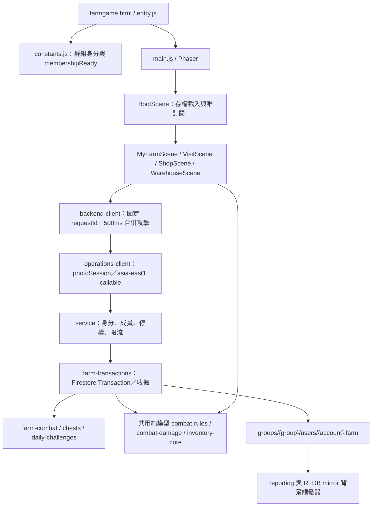

# 01－武器精煉前的現有系統分析

日期：2026-11-27（台灣時間）。來源 commit：`0233ffd632d82ac0cede326d508718ea3cdbe734`。

> **規範核對缺口**：本機、工作目錄搜尋及 GitHub `main` 均未找到 `docs/weapon-refinement/DEVELOPMENT_RULES.md`，已向使用者詢問。沒有自行建立或假裝讀過該文件。本階段依使用者明文限制只盤點、隔離測試及寫文件；文件可以審查，但不能宣稱已完成該規範核對，也不授權進入 Phase 2。

本文的「現有」表示程式碼實際存在，不表示已查證正式部署／資料庫內容。沒有讀取正式玩家、發布設定、正式 Rules release 或 IAM；目前數值為程式預設。新設計集中於 [03](03-migration-design.md)，不將提案冒充現有 API。

## 1. 模組與相依關係



共用純模型由 `scripts/prepare-game-admin.cjs` 白名單複製至 Functions 的 `game/`。不應讓新純模型 import `constants.js`、DOM、Firebase Auth 或 Phaser，否則可能形成啟動循環相依。

## 2. 十四項盤點

| 範圍 | 實際檔案、函式／符號 | 資料／實際行為 |
|---|---|---|
| 1. 武器商品及原始能力 | [`combat-rules.js`](../../js/farm/combat-rules.js)：`LEGACY_WEAPONS_CONFIG/WEAPONS_CONFIG/WEAPON_ATTACK/weaponDamage`；後端 `combat-balance.cjs`：`defaults/validate/merge/config` | 種類目錄＋可覆寫戰鬥設定。價格／可購買狀態不是同一份動態精煉設定 |
| 2. 買賣／發獎 | `ShopScene.executeBuyWeapon/executeSellItem`；`farm-transactions.createFarmTransactions().handle` 中 `buyWeapon/sellItem`；`domain.rewards/award`；`service.redeem`；`chests.open/openMany` | 都按武器種類增加／減少數量；尚無 Instance ID |
| 3. 倉庫 | `WarehouseScene.create/renderWarehouseItems/warehouseItemCount/handleItemClick`；`inventory-core.INVENTORY_KEYS/getUsedSpace` | 同款顯示一格圖示＋總數；每把武器數量納入容量 |
| 4. 裝備 | `WarehouseScene.toggleEquipWeapon`；`combat-rules.equippedWeapon/equippedBow`；`handle` 的 `equipWeapon/discardItem` | 近戰／弓各一個種類 ID；`currentlyEquipped` 用於狀態核對，不是個體版本 |
| 5. 傷害 | `combat-damage.makeCombatSnapshot/hitResult/hitDamage/batchDamage/maximumHealth` | 現行基礎傷害 ±10，伺服器種子＋命中索引重算，非前端任意傳 damage |
| 6. 爆擊／連續爆擊 | 同檔 `criticalAt`（內部函式）、`hitResult` | V4 爆擊 1.5 倍；基礎與連續獨立判定取 OR，模式分開記連段 |
| 7. 攻擊對象 | `combat-rules.damageByEnemy/weaponDamage`；後端 `farm-combat.combatCommand` | 種類限制＋伺服器 mode／怪物白名單＋快照傷害非零三重約束 |
| 8. 死亡／戰利品／寶箱 | `farm-combat.combatCommand` 內 `start/resolve`；`chests.drop/open/openMany/list`；`battle-reward-feedback.showBattleReward` → `battle-reward-ui.openBattleReward` 接線及 `chest-ui.openChestInventory` | 伺服器有效擊退才發獎；原戰利品與額外箱同結算。開箱才取得箱內獎勵；每批最多 20 箱 |
| 9. 簽到／任務／禮包／排行／圖鑑 | `daily-challenges.createDailyChallenges` 回傳 `handle/prepareProgress/consumeVerifiedEvent/adminRead`；`daily-scope`；`service.redeem`；`farm-ranking.createFarmRanking().load`；`ranking-core.rankFarmPlayers`；`hud-ui.mountFarmHud` | 日獎分群組；禮包領取限額按 accountId；排行按 group＋account 分列。圖鑑按鈕 `button('guide','圖鑑',true)` 尚未開放，不能算完整圖鑑系統 |
| 10. 金幣／物品交易 | `farm-transactions.handle`、`domain.award`、`daily-challenges.handle`、`management.mutate` | 正常路徑由 Admin SDK 交易更新 farm；存在 legacy 前端分支，見第 7 節 |
| 11. Firestore／索引／規則 | root `firestore.indexes.json`、`game-admin/rules/firestore.indexes.json`、`rules/firestore.private-farm.candidate.rules`、`firebase*.json` | root 索引 38 組＋3 個 fieldOverrides；admin 索引 39 組＋1 個 override；兩份不相同，皆不等於已部署清單 |
| 12. 後端 | `game-admin/functions/index.cjs/callables.cjs/service.cjs`；`functions/index.cjs` | nexus-ops 六個 callable；nexus-live 登入／讀取橋接及鏡像。主要遊戲客戶端指向台灣，callable 原始碼仍雙區 |
| 13. 營運權限 | `service.admin/adminAPI/transactionSession/player`；`domain.adminIdentity`；`management.query/mutate`；`game-admin/site/app.js/management.js` | token admin claim 後仍向 Auth 查當前 customClaims；不能用 `users.role` 充當營運 admin |
| 14. 快取／PWA | `farm-daily-sw.js`、`public-art-worker.js`、`public-art-cache.prepareFarmArtCache/artCacheStartup`、`entry.js`、`daily-preview-cache.js`、`save-store.startFarmSaveSession` | SW 只快取同源公開圖片及 atlas JSON，不快取遊戲 JS／HTML／API／錢包。舊分頁仍可能執行舊 JS，不能靠更新 SW 取代後端版本 gate |

## 3. 實際武器、數值與攻擊限制

`WEAPON_ATTACK` 預設如下；正式 `ops_game_config/combat.weapons` 可覆寫 attack／criticalRate／chainCriticalRate。程式預設兩種率各 5%。

| ID | 名稱 | 攻擊 | 買價 | 賣價 | 可攻擊 |
|---|---|---:|---:|---:|---|
| club | 木棒 | 20 | 隱含初始 | 無 | 地面組 |
| mace | 狼牙棒 | 60 | 2,000 | 1,000 | 地面組 |
| battleaxe | 雙手斧 | 120 | 5,000 | 2,500 | 地面組 |
| ironhammer | 大鐵槌 | 200 | 15,000 | 7,500 | 地面組 |
| katana | 武士刀 | 400 | 500,000，`purchasable:false` | 30,000 | 地面組 |
| shortbow | 短弓 | 80 | 1,000 | 500 | 遠程組 |
| huntingbow | 獵弓 | 160 | 5,000 | 2,500 | 遠程組 |
| paladinbow | 聖騎士弓 | 320 | 10,000 | 5,000 | 遠程組 |

地面組：wolf、tiger、mole、cobra、gorilla、giant。遠程組：dragon、eagle、hornet、cobra、giant。**眼鏡蛇王與遠古巨人同時可近戰及遠程**；不是所有地面怪都只能近戰。

預設怪物 HP／時限（`farm-combat.CONFIG`；HP 可由戰鬥設定覆寫）：

| ID | 顯示名稱 | HP | 時限 |
|---|---|---:|---:|
| wolf | 大野狼 | 300 | 60 秒 |
| tiger | 老虎 | 400 | 50 秒 |
| eagle | 巨飛鷹 | 800 | 60 秒 |
| dragon | 烈火龍 | 1,600 | 60 秒 |
| hornet | 虎頭蜂 | 2,400 | 50 秒 |
| gorilla | 大金剛 | 4,000 | 40 秒 |
| mole | 地鼠 | 4,000 | 60 秒 |
| cobra | 毒牙眼鏡蛇王 | 6,400 | 50 秒 |
| giant | 遠古巨人 | 12,000 | 70 秒 |

## 4. 存檔與交易結構

```text
users/{profileId}                       accountId、公開名稱／狀態
ops_identity_credentials/{profileId}   私有登入版本／身分
ops_identity_state/global             ready／farmReady

groups/{groupId}/users/{accountId}
  farm.coins
  farm.mace / battleaxe / ironhammer / katana / shortbow / huntingbow / paladinbow
  farm.equippedWeapon = 種類 ID
  farm.equippedBow = 種類 ID 或 null
  farm.warehouseLimit、其他物品數量
  farm.hensState、readyEggs、combatKills、各怪物 Results、chestCount
```

這是程式結構示意，不是正式玩家匯出。初始木棒不在 `INVENTORY_KEYS`，沒有可精煉的現成個體；`initialFarm()` 只設 `equippedWeapon:'club'`。失效近戰裝備會回退木棒。

`farm-transactions.handle` 讀取身份／farm／戰鬥會話／收據，驗證伺服器價格與數量後提交；`ops_farm_transactions/{hash(uid:requestId)}` 記 fingerprint 和 response。重送同 ID 同參數重播；不同參數拒絕。限流與經濟交易分開，限流不是扣款原子性的來源。

`backend-client.farmCommand` 用 group/account/action/payload 的 sessionStorage key 保留 requestId；不確定錯誤不直接換 ID。`farmCommandOrLegacy` **只依旗標選分支，不是在網路失敗時降級到前端直接寫入**。

戰鬥協定現為 `combatVersion:2 / damageVersion:4`；`battle-page-client.createBattlePage` 使用 `beginBattlePage` 登記新頁面，離頁 `abandonBattlePage`，新頁可作廢舊戰鬥。`farm-combat` 比對 kinds、期限、firstHit、累計速率（近戰 20／秒、遠程 10／秒，加少量 burst）與武器種類，再用 `batchDamage` 驗證。

爆擊 V4：`round(normal × 1.5)`；舊 V3 仍有 2～3 倍分支，舊協定不能直接當成 V4。前端可取得 damageSeed，屬可預測、可重算序列；後端驗算不等於已證明真實瞄準或完全防外掛。

爆擊 p、連續率 q：非爆擊後下一擊為 p，爆擊後為 `p+(1-p)q`；5%／5% 為 9.75%，不是每擊都 9.75%。近戰、遠程各自計數。

## 5. 已存在的資料路徑／API

下表是原始碼使用或查詢的路徑，**未查證正式文件是否存在**。

| 路徑 | 使用者／用途 |
|---|---|
| `ops_farm_transactions/{id}` | farm 經濟收據 |
| `ops_farm_active/{id}` | 每 profile＋群組的戰鬥／進場許可 |
| `ops_verified_farm_events/{id}` | 交易內建立可信任遊戲事件 |
| `ops_farm_chests/{ownerHash}/boxes/{id}` | 個別寶箱、歸屬、內容快照、開啟結果 |
| `ops_game_config/combat`、`encounters`、`chests`、`guard-dogs` | 戰鬥、出現條件、寶箱與護衛犬設定 |
| `ops_daily_configs/current`、`ops_daily_states/{id}`、`ops_daily_days/{id}`、`ops_daily_grants/{id}`、`ops_daily_events/{id}` | 每日設定、日快照、進度與發放去重 |
| `ops_gifts/{id}`、其 `claims/{hash(accountId)}`、`ops_code_index/{hash}`、`ops_receipts/{id}`、`ops_redemptions/{id}` | 禮包內容、名額、收據、兌換紀錄 |
| `ops_announcements`、`ops_notifications`、`ops_events`、`ops_feed_versions/global` | 公告、通知、活動與版本通知 |
| `ops_settings/global`、`ops_player_controls/{uid}`、`ops_limits/{hash}` | 營運開關、停權、限流 |
| `ops_admin_requests/{id}`、`ops_audit/{id}` | 管理冪等與前後值稽核 |
| `ops_farm_report_events/{id}`、`ops_report_meta/farm` | 已提交 farm 變化與報表覆蓋起點 |
| `groups/{g}/users/{a}/farm_meta/creation`、`farm_notifications/{id}` | 建檔防重與農場通知 |
| `rooms`、`messages` | 村落廣播；不是武器庫存 |

實際 nexus-ops callable：`gameOpsAdmin / gameOpsAnnouncements / gameOpsFarmTransaction / gameOpsGuardDog / gameOpsDailyChallenges / gameOpsRedeem`，由 `createCallables` 包裝。`gameOpsFarmReportCapture` 及公告版本函式是觸發器，不能當玩家 API 呼叫。

`gameOpsAdmin` 既有 action 包含 `gameBalance/combatBalance/saveCombatConfig/saveChestConfig/saveEncounterConfig/adjustPlayerCoins` 等，由 `management.query/mutate` 實作；目前不存在精煉 API、精煉石、武器個體集合、精煉版本發布或精煉統計。

## 6. 獎勵與排行榜的隔離邊界

- 日獎使用 `daily-scope.scopeKey/scopedRef/owns`，按 profile、account、group 隔離；三種任務為收蛋 3 次、幫忙清潔 3 次、擊退 3 次，預設只發金幣。
- 禮包 `service.redeem` 的 claims 目前按 `accountId` 計名額，並非按農場分開。個體化不能順便把同帳號跨群組的禮包名額擴大。
- 排行 `farm-ranking.load` 依分數每頁 25 筆查 collectionGroup users、驗證公開村落／成員、補玩家資料，完整讀完同分再沿用排序，安全上限 5,000 候選。
- `rankFarmPlayers` 按 `[groupId,accountId]` 分列；本期欄位 `stolenEggs20261123 / monsterKills20261123`，期間程式為 11/23 06:00～11/30 00:00 台灣時間。沒有因此推定未來週期已自動化。
- 已有排行榜獎勵說明與活動管理，不等於已確認完整自動週獎派發器。圖鑑為未開放入口；「武器圖鑑／雞隻圖鑑」說明頁不等於有收集里程碑帳本與獎勵後端。
- 寶箱目前 `items` 為全部發放清單，沒有每個物品的獨立權重；原戰利品以外是否掉箱由怪物設定決定。武器通常可作寶箱 stock 發放，護衛犬／場景／升級服務在目錄標為不支援。

## 7. 前端直接改資源的路徑盤點

目前程式旗標：`js/identity-config.js` 的 `PRIVATE_IDENTITY_ENABLED=true`、`js/farm/backend-client.js` 的 `FARM_BACKEND_ENABLED=true`；不是已驗證的正式伺服器參數值。

| 檔案／函式或區塊 | 保留的直接交易 | 目前旗標 true 的正常入口 |
|---|---|---|
| `ShopScene.executeBuyWeapon/executeSellItem/executeBuyMedicine/executeTradePoultry/executeUpgradeCoop/executeExpandWarehouse` | `runTransaction` 改 coins／數量／容量 | `farmCommandOrLegacy` 選 server，失敗不自動執行 legacy |
| `WarehouseScene.toggleEquipWeapon/feedItem/discardItem/handleItemClick` 相關 housing | `runTransaction` 改裝備／物品／雞隻 | 同上，選 server |
| `save-store.ensureFarmSave` | legacy 建 farm／creation | true 時先 return `farmCommand('ensureFarm')` |
| `MyFarmScene` 清潔／收蛋／治療／settle、抓蟲區塊 | legacy `runTransaction` 改物品／農場 | 包裝或 true 時先 return `searchGarden` 等後端 action |
| `VisitScene.runVisitTransaction`、clean／steal／狼虎結算分支 | 直接交易改自己與目標 farm | 只供 legacy callback；true 時用後端進場、偷蛋、清潔、戰鬥結算 |
| `dragon.settleDragonEncounter`、`eagle.settleEagleEncounter`、gorilla／hornet 結算、mole/cobra/giant store | legacy 戰利品／金幣／結果交易 | true 時先 return 後端 settle／claim 路徑 |
| `mail-store.createFarmMailStore`：準備、讀取、領取、刪除 | legacy farmMail／歡迎獎勵 | true 時使用 ensureWelcome/readMail/claimWelcome/deleteMail |
| `js/farmgame.js` 舊單頁農場 | 收蛋、買雞、賣蛋與偷蛋直接交易 | 目前 `farmgame.html` 載入 `js/farm/entry.js`，未找到目前 HTML 引用舊單頁檔；檔案仍存在 |

結論：**前端直寫程式確實仍存在，但不能把「源碼有 legacy 分支」等同「目前正常模式正在直寫」。** 已執行的 private-mode 瀏覽器測試會拒絕客戶端 farm transaction；正式 Rules 是否確實保護仍待查證。過期頁面、手工呼叫 SDK 或改前端旗標必須被 Rules 拒絕，不能只信 UI。

## 8. 規則、索引、區域與管理權

- root `firebase.json` 的 firestore 只有 indexes，沒有完整 Rules 路徑。`game-admin/rules/*fragment.rules` 明示為片段；完整候選為 `rules/firestore.private-farm.candidate.rules`，測試配置另指定它。不可把候選或舊使用者提供的 reference 當成目前正式 release。
- 候選限制客戶端改 farm／farmMail；ops 根集合未放行。但 group user 的一般子集合仍可由本人寫（排除 farm_meta／farm_notifications）。新個體若放在這裡，不能只加更內層 deny；Firestore allow 匹配為 OR。
- root 索引有三個排行欄位 fieldOverrides（11/16 偷蛋、11/23 偷蛋、11/23 打怪）；admin 索引檔只有舊 11/16 override。不得用其中一份整檔覆蓋正式索引。
- `operations-client.connect` 指向 `asia-east1`；`callables.cjs` 正式 callable 為新加坡＋台灣。`gameOpsFarmReportCapture` 源碼仍新加坡；鏡像也有原區域配置。沒有盤點正式 instance，不宣稱全數同區。
- `gameOpsFarmTransaction` 的 App Check 源碼為 false；身分／可變成員、停權及 sessionVersion 仍查驗。不能把 App Check 未強制說成沒有授權。
- admin 除 token role 還查 Auth 目前 claim，`management.mutate` 有 expectedRevision／expectedCoins、reason、原子稽核與防重；尚無完整精煉草稿／排程／歷史版本管理。

## 9. PWA 與快取的實際範圍

`public-art-worker.js` 只攔同源 `assets/farm/` 的 png/webp/jpg/gif/svg/json；用 manifest 每檔 digest 做內容快取，排除 manifest 本身的直接攔截。新版 art worker 會 skipWaiting／claim，但只處理美術，不能證明頁面的 JS 已更新。舊 daily worker 分支只快取 daily PNG。

`entry.js` 對動態模組下載 TypeError 最多透過新文件重試一次（120 秒視窗），不反覆初始化 Phaser；真正程式錯誤不當下載錯誤無限重載。

`save-store.startFarmSaveSession` 區分 fromCache／hasPendingWrites，保留已確認存檔並在線上重試，不以空快取覆蓋現有農場。`daily-preview-cache` 只供預覽，不能授權領獎。

`REALTIME_READS_ENABLED=false` 是目前原始碼狀態，讀取主路徑仍 Firestore；已有 RTDB mirror 會複製整份 farm。未來個體私有歷史不應嵌入公開 farm，也不能靠關掉前端開關視為鏡像不存在。

## 10. 檔案定位索引

上文純模型與畫面類別的完整路徑：

- `js/farm/combat-rules.js`、`js/farm/combat-damage.js`、`js/farm/inventory-core.js`、`js/farm/ranking-core.js`。
- `js/farm/ShopScene.js`、`js/farm/WarehouseScene.js`、`js/farm/MyFarmScene.js`、`js/farm/VisitScene.js`、`js/farm/BootScene.js`。
- `js/farm/backend-client.js`、`js/farm/operations-client.js`、`js/farm/save-store.js`、`js/farm/daily-preview-cache.js`、`js/farm/public-art-worker.js`。
- `game-admin/functions/combat-balance.cjs`、`game-admin/functions/farm-combat.cjs`、`game-admin/functions/farm-transactions.cjs`、`game-admin/functions/chests.cjs`。
- `game-admin/functions/domain.cjs`、`game-admin/functions/service.cjs`、`game-admin/functions/management.cjs`、`game-admin/functions/farm-ranking.cjs`、`game-admin/functions/daily-challenges.cjs`、`game-admin/functions/daily-scope.cjs`。

這些是現有正式原始碼的定位，並非本階段修改清單。未來預計影響的模組與所有資源 writer 對照見02；新提案路徑只列於03。
