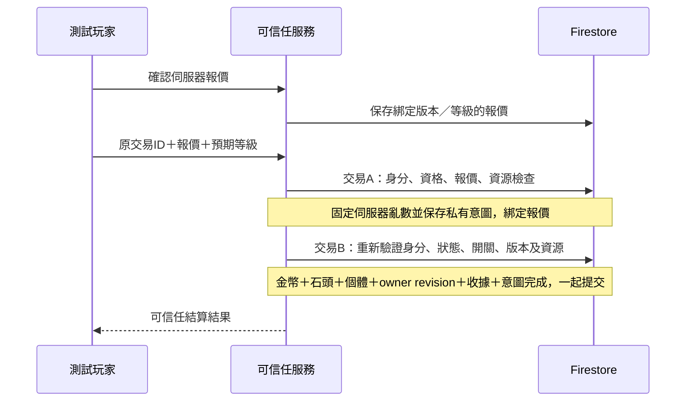

# Phase 3－武器精煉核心服務與可信任後端交易

日期：2026-11-27（台灣時間）。Git 基準仍為 `8dbae59e619cc5382853dfeb0e6397eccddd209a`，本階段疊加在尚未提交的 Phase 2 工作目錄上。未推送、未部署、未讀寫正式玩家資料，未進 Phase 4。

## 1. 驗收前提與本階段狀態

已讀取開發總規範、Phase 1 文件、Phase 2 報告及證據。**Phase 2 不能宣稱「所有層級驗收完成」**：原有 18 項個體化測試已重新通過；先前 487 項單元與29組瀏覽器的原始結果保留，但真實 Firestore／Rules／競態 Emulator 本次補跑仍因下載 HTTP403 `Domain forbidden` 阻擋。

本次另外發現 Phase 2 新 ID 計算未包含 owner scope，當不同農場使用相同 generation 時，文字 ID 可能相同。原本按 owner 私有路徑查詢仍隔離資產，並非能操作他人資產；已修正**新 ID**的算法、加入全域不同 scope 測試。舊 ID 保持可讀、不直接改號。舊算法尚在 staging 的測試移轉需先安全 rollback、改 generation 重跑，禁止混用兩套編號續跑。新 header／journal 記 `instanceIdVersion:2`。沒有任何正式移轉。

因此本交付是依本次明確授權完成的**隔離開發與測試成果，驗收仍有環境／回歸限制**，不能作為正式啟用或部署的通過證明。最終測試結果與初次失敗／重跑紀錄見第9節及 evidence，不能抹除失敗紀錄。

正式預設：

```js
weaponInstanceEnabled = false;
weaponRefinementEnabled = false;
refinementCombatBonusEnabled = false;
```

三者均為 server code literal，不從玩家請求、營運資料或環境變數覆寫。沒有接入正式戰鬥加成。測試用 constructor 注入僅供隔離 harness，正式 Functions 建立服務時不注入。

## 2. 實際新增／調整檔案

| 檔案 | 本階段內容 |
|---|---|
| `game-admin/functions/refinement-core.cjs` | 純模型：版本／參數驗證、BP、資格、能力、下一級、成本、機率、保底、成功／失敗狀態計算 |
| `game-admin/functions/refinement-config.cjs` | 不可覆寫設定版本、active pointer、revision、發布防重與稽核寫入計畫 |
| `game-admin/functions/refinement-service.cjs` | 身分、報價、固定隨機意圖、原子結算、結果查詢、發布／讀取設定服務 |
| `game-admin/functions/weapon-instance-config.cjs` | 新增兩個 false 預設值，原個體化開關仍false |
| `game-admin/functions/weapon-repository.cjs` | 稀疏個體狀態讀取／分頁；拒絕直接出售／丟棄精煉武器；新配置 ID 納入 scope |
| `game-admin/functions/migrations/weapon-instances.cjs` | 新 ID 版本標記／scope，新舊 staging 防混用；正式仍不可使用 |
| `game-admin/functions/service.cjs` | 沿用現有 farm callable 分派新 action；管理 API 沿用當前 admin claim 檢查 |
| `js/farm/weapon-instance-ui.js` | 原個體卡片正確顯示既有 +N；精煉物不可直接售出／丟棄。沒有新增精煉入口或精煉操作 UI |
| `game-admin/tests/helpers/refinement-fixture.cjs` | 只有測試資料的移轉、設定發布、可控亂數與服務 fixture |
| `game-admin/tests/refinement-core.test.cjs` | 純模型、參數、取整、保底、邊界 |
| `game-admin/tests/refinement-service.test.cjs` | 防重、競態、權限、報價、版本、恢復、交易重試、安全與不套戰鬥驗證 |
| `tests/weapon-refinement/refinement-cost-probe.cjs` | 獨立MemoryDB文件操作計數器，不連接Firebase |
| `game-admin/tests/refinement.emulator.cjs` | 真實 Firestore 並行／恢復與候選 Rules 禁止直寫的測試；下載阻擋，尚未跑到 assertion |
| `docs/weapon-refinement/DEVELOPMENT_RULES.md` | v1.2 補記使用者 Phase 3 明確範圍，保留歷史限制與驗收缺口 |
| 本報告、`evidence/phase-03-2026-11-27/` | API、結果、來源雜湊、費用與限制 |

Phase 2 已存在的改動仍在工作目錄，不將它們冒稱本階段全部新寫。未修改戰鬥純模型、商品售價、怪物時限、正式 Rules／索引或 Functions 部署區域；原不相關文件未修改。

## 3. 設定、精度與能力

### 初始設定

| 級 | 攻擊累計 BP | 爆擊累計 BP | 連續爆擊累計 BP | 成功 BP | 金幣 | 精煉石 |
|---|---:|---:|---:|---:|---:|---:|
| +1 | 300 | 100 | 100 | 10000 | 1000 | 1 |
| +2 | 600 | 200 | 200 | 9000 | 2000 | 1 |
| +3 | 1000 | 300 | 300 | 8000 | 3000 | 1 |
| +4 | 1400 | 400 | 400 | 7000 | 4000 | 1 |
| +5 | 1900 | 500 | 500 | 6000 | 5000 | 2 |
| +6 | 2500 | 700 | 700 | 5000 | 5000 | 2 |
| +7 | 3200 | 900 | 900 | 4000 | 5000 | 2 |
| +8 | 4000 | 1200 | 1200 | 2000 | 5000 | 3 |
| +9 | 5000 | 1500 | 1500 | 1000 | 5000 | 3 |

`100 BP = 1%／1個百分點`，機率 `10000 BP = 100%`。所有設定為安全整數；同版本三項累計加成逐級遞增，攻擊最多5000BP、兩種率最多1500BP。成本為非負安全整數，額外硬上限單次10億金幣／100萬石，保底門檻最多100萬次。初始九級保底全部關閉、門檻0；啟用時門檻至少1。

- 攻擊＝原始 attack × `(10000 + 累計攻擊BP) / 10000`，用 BigInt 算有理數後做正數四捨五入，符合現有傷害計算使用 `Math.round` 的正數取整語意，不逐級相乘。木棒20的+1為21，+2仍可能為21，+9為30；百分比確實增加不代表每級整數攻擊都跳1。
- 機率＝原始機率BP＋累計增加BP。原有百分比小數轉BP採十進位四捨五入，例如1.005%→101BP，避免二進位浮點的半位偏差。此為新精煉能力服務精度，**不改現行戰鬥的機率算法**。
- 原始能力在該個體第一筆有效結算時凍結，成功或失敗都保存 baseStatsSnapshot。已有快照的武器不再跟隨後台基礎能力下調。
- 下一次成功使用新版本該目標級的累計加成；任何一項低於已取得快照即拒絕並記 `CONFIG_CONFLICT`，不將兩版加成相加，也不直接調低舊快照。
- 若原始機率＋加成超過100%，明確拒絕並記 `RATE_CAP_CONFLICT`，不默默截斷或削弱。這是尚未正式開放前的安全限制；將來機率封頂政策需先確認。
- 爆擊倍率、±10、合併命中、怪物限制與HP／時限完全不接這份能力。本版即使測試精煉已裝備武器，原戰鬥快照／命中序列也相同。

## 4. 新增資料結構

所有私有資料皆位於既有 `ops_*` 保護命名空間，不放在允許本人直接寫入的一般 group user 子集合。

```text
ops_refinement_versions/{version}
  schemaVersion:1, version, effectiveAt, levels[9]
  contentHash, publishedBy, publishedAt

ops_game_config/refining
  schemaVersion:1, activeVersion, revision, updatedBy, updatedAt

ops_refinement_config_requests/{hash(adminUid:requestId)}
  fingerprint, response, createdAt

ops_weapon_owners/{ownerHash}/states/{instanceId}
  schemaVersion:1, instanceId, weaponId, ownerId, generation
  revision, refineEpoch:0
  refineLevel, refineBonus:{attack,criticalRate,chainCriticalRate}
  refineBonusUnit:'basis-points', refineStatsVersion
  refineFailCount, failuresByTarget:{targetLevel:failures}
  successfulRefineCost:{coins,stones}, failedRefineCost:{coins,stones}
  baseStatsSnapshot:{attack,criticalRateBp,chainCriticalRateBp,combatRevision}
  createdAt, updatedAt

ops_refinement_quotes/{quoteId}
  ownerId, instanceId, configVersion, configHash
  binding, confirmationHash, base, view, eligibility
  createdAt, expiresAt, acceptedBy?

ops_refinement_intents/{hash(profileId:requestId)}
  ownerId, requestId, fingerprint, instanceId, expectedLevel
  quoteId, configVersion, rollBp?                  # 只留在私有後端
  status:pending | completed | rejected, error?, timestamps

ops_refinement_transactions/{hash(profileId:requestId)}
  ownerId, fingerprint, intentId, response, createdAt

ops_refinement_conflicts/{hash(scope,requestId)}
  ownerId, instanceId, reason, requestId, createdAt
  configVersion, acquiredStatsVersion, currentLevel, targetLevel, currentBonus, nextBonus
```

既有 Phase 2 allocation＋ordinal ID 不重寫；新建 ID 已納入 owner scope（見第1節）。只有被操作的個體建立稀疏 state，不會把同一批次的兄弟武器一起升級。owner 加 `hasRefinementStates:true` 及更新 revision；farm 只更新 coins、`refinementStones` 與既有 `weaponInstanceRevision`。不複製商品／圖像資料，不公開歷史或亂數。

`farm.refinementStones` 是本版隔離測試使用的材料餘額欄位，未存在視為0、負數／小數／不安全整數拒絕。**沒有加入初始發放、商店、禮包、每日或寶箱目錄，也尚未實作倉庫石頭圖示／容量政策。** 現有庫存容量模型尚不計入這個未上線材料；在決定占格政策與完成取得流程前，不得正式開放。其他既有交易保留 farm 未知欄位，不能回蓋材料餘額。

稀疏 state 儲存已取得能力與成本，設定版本可追溯；版本文件不可透過發布服務覆寫。版本發布紀錄與 `ops_audit` 保存前一指標及新版本雜湊。只支援立即生效，不提供排程發布或營運前端 UI。

## 5. API 規格

沿用現有 **`gameOpsFarmTransaction`** callable，不新增 Functions 名稱或部署設定；API仍由既有 Auth／私有登入／群組／成員／停權驗證包裝。不能把下面 `data` 直接當成免登入 HTTP API。

### 5.1 `getRefinementStats`（唯讀）

```json
{"action":"getRefinementStats","groupId":"TEST_GROUP","requestId":"QUERY_ID_001","instanceId":"INSTANCE_ID"}
```

回傳 `result.instanceId/refineLevel/refineBonus/refineBonusUnit/refineStatsVersion/stats`。已有+9、功能停用或新發布設定損壞時仍可讀已取得快照；不影響戰鬥，不花材料。

### 5.2 `previewRefinement`（伺服器報價）

```json
{"action":"previewRefinement","groupId":"TEST_GROUP","requestId":"QUOTE_ID_001","instanceId":"INSTANCE_ID"}
```

回傳 quoteId、configVersion／hash、expiresAt、baseStats、currentLevel／targetLevel、currentStats／nextStats、bonus、cost、successRateBp、effectiveSuccessRateBp、pity 及 eligibility。餘額不足可看報價／資格，執行仍會重新檢查。+9、無效設定、0%且無保底、戰鬥中、移轉中或功能關閉不提供可執行報價。

報價有效120秒。固定報價綁定 owner revision、個體 revision／輪次、generation、設定內容／指標 revision、原始能力與下一級三項累計加成、成本、成功率及保底；同報價 requestId 重送回原報價，不悄悄改價。

### 5.3 `refineWeapon`

```json
{
  "action":"refineWeapon",
  "groupId":"TEST_GROUP",
  "requestId":"TRANSACTION_ID_001",
  "instanceId":"INSTANCE_ID",
  "expectedLevel":0,
  "quoteId":"SERVER_QUOTE_ID",
  "configVersion":"refinement-v1"
}
```

不接受 ownerId、成本、成功率、roll、success、金幣或材料指定值；未知欄位直接拒絕。既有 battlePageId 僅為相容傳輸欄位，不授權發獎，也不納入經濟指紋，讓重新載入後仍能確認原交易。

成功與抽籤失敗都回已完成結果：`transactionId/instanceId/success/previousLevel/refineLevel/refineBonus/configVersion/acquiredStatsVersion/stateRevision/ownerRevision/actualCost/stats/successfulRefineCost/refineFailCount/coins/stones/completedAt`。`success:false` 是有效失敗結算，已扣本次資源；不是網路錯誤。回傳餘額是該次結算快照，不代表重播時的最新錢包。

同交易 ID 對不同語意內容回 already-exists。此 ID 在同 profile 的精煉命名空間內跨群組防重；原遊戲／禮包等收據命名空間未合併。

### 5.4 `getRefinementResult`（唯讀）

```json
{"action":"getRefinementResult","groupId":"TEST_GROUP","requestId":"LOOKUP_ID_001","transactionId":"TRANSACTION_ID_001"}
```

回傳 status=`pending/completed/rejected`。completed 含原結算結果；rejected 含公開錯誤；pending 只表示意圖已保存、未確認結算。**不回傳 rollBp，也不在查詢中自動開另一筆扣款。**

程序中斷後，先查原 transactionId；pending 可用原完整 payload、原 ID 再呼叫 refineWeapon 確認。若報價已過期／設定已變，記錄拒絕且不扣款，重新確認後使用新交易。completed 即使開關已關仍可查／重播，沒有再次扣款。

### 5.5 管理 API（後端，沒有新增 UI）

沿用 `gameOpsAdmin`：

- `action:'refinementConfig'`：只讀當前設定，未發布回 configured=false＋初始defaults，不自動建立。
- `action:'publishRefinementConfig'`、payload=`{config,expectedRevision}`、requestId：沿用現行 token admin ＋Auth當前 customClaims 驗證；需精煉及個體化開關／可信任後端已開，正式預設會拒絕。測試才注入開關。

發布使用新版本 ID，驗證九級完整性及精度；舊 ID 不可覆寫，指標與版本、稽核、發布收據原子提交。前一設定 revision 不符即拒絕。失敗也沿用既有管理稽核流程。

## 6. 原子交易、亂數及併發



- 安全亂數使用 `crypto.randomInt(10000)`，均勻0～9999，`roll < successRateBp` 成功；100%必成。只在缺少有效既有意圖、所有前置驗證通過時抽取，不從玩家資料／戰鬥種子取值。
- 同一 invocation 的 callback 重試使用閉包保留同一抽樣；不同 invocation 讀取已持久化意圖。真正同時的首次呼叫可能各產生候選值，但只有提交成功的意圖有權威，另一個重試後採已存值；未提交候選不對外顯示，也不影響結果。
- 抽樣及報價綁定在交易A保存。程序在A後中斷不扣經濟資源；新 invocation 重用同意圖，不重抽。
- 交易B才同時扣金幣／石頭、更新個體等級／三項加成／成功及失敗歷史成本、owner／farm revision、不可變結果及完成狀態。任一寫入失敗整筆不提交，意圖可重試。
- 業務拒絕會永久記 rejected，不允許用同 ID 換報價／武器再抽。未知儲存／網路錯誤不假裝拒絕或完成，保留 pending。
- 報價只可由一筆交易 ID接受；兩台裝置兩份報價仍共用個體／owner revision，只有一筆能在原狀態完成，另一筆需重新確認。
- 出售若先贏，精煉讀取會發現個體已移除而不扣款；精煉若先贏，原出售 revision 失效。已精煉武器不允許直接出售／丟棄，解除精煉尚未在本階段實作，不自動退費。
- 本版用整個 owner revision 作保守的跨裝置衝突鎖；即使另一把武器發生操作也可能要求重取報價，避免無意間把舊確認變成新交易。
- 未完成戰鬥、移轉及失效／撤銷身分會阻擋精煉。既有可變權限在每筆 Transaction 內重新檢查，不跨交易快取權限。

## 7. 保底與版本保護

- 保底以 `instanceId + targetLevel` 分開，不跨武器或不同目標級共用。
- `guaranteeAttempt=N` 代表本目標前面已失敗N-1次時，本次必成。成功後重置該目標失敗進度與當前失敗數，歷史每次成本／結果仍在交易收據。
- 成功率0且保底關閉直接禁止；測試設定若啟用保底則可累積失敗直到保證次數。預設不啟用、不暗中加保底。
- 新政策可以調高未來加成，但不直接重算舊快照；下一級若降低任何一項則停止，記錄設定衝突。
- 原始能力快照、精煉版本與實際成本分開保存；不能拿目前設定推算歷史成功成本，為後續解除精煉保留資料。

## 8. 資安基準與正式啟用限制

候選 Rules 已禁止一般 client 更改 farm／farmMail，且對所有 `ops_*` 根集合及其子集合沒有開放。新增個體精煉狀態、抽樣、結果、設定均放 ops 根下；不在 group user 的泛用子集合中新增可被本人寫的權威資料。

本次**沒有部署或修改 Rules**。候選規則不等於已驗證正式 release；安全斷言測試已建立，仍因 Emulator 阻擋未跑。不得藉由收窄／放寬正式 Rules 強行啟用，原 legacy 前端 writer 的相容及雙區後端保護仍須在正式切換前完整確認。

API 測試涵蓋未登入、跨owner／群組、撤銷sessionVersion、非admin與撤銷admin claim、竄改費用／機率／結果、不同內容重用ID及開關關閉。新功能沒有可由HTTP參數啟用的旗標。

可控 RNG／程序中斷 hooks 只存在測試 constructor；非明確 testEnvironment 注入會拒絕建立服務。正式建立 service 不提供測試選項；HTTP未知欄位嚴格拒絕。沒有玩家端可指定的隨機值。未精煉的DTO現在明確回 refineStatsVersion=null、stateRevision=0 與 basis-points 單位，避免把Phase2的0哨兵當成真實設定版本。

## 9. 測試與證據

機器可讀結果、命令、來源與日誌 SHA 見 [phase-03-summary.json](evidence/phase-03-2026-11-27/phase-03-summary.json)。

- 新純模型／交易／既有可信任服務整合：39項通過；全部單元最終526項通過、0失敗（39已包含其中，不重複加總）。包含全部需求案例、BP半位取整、跨版本能力保護、pending恢復、callback重試、兩裝置與出售競態，以及精煉已裝備武器後戰鬥快照不變。
- Phase 2 原有18項測試本次重跑通過，另補相同generation跨scope的ID案例。
- 全部單元與既有瀏覽器矩陣重跑；**首次並行矩陣中 combat_feedback_tests 與 critical_feedback_tests 在同一「血條距頭0.3cm」斷言失敗**。未改容差、未改戰鬥程式，原日誌保留；初跑27/29通過；上述兩組單獨重跑2/2通過，另重跑Phase2實際武器入口也通過。不把重跑覆蓋原失敗，仍列為不穩定項目。
- 真正 Firestore Emulator：本次嘗試 Phase 2 與 Phase 3 套件，仍於下載JAR回HTTP403，未執行 assertion。不將 MemoryDB 的序列化並行當成真正 Firestore contention。
- 真實手機、正式資料／Rules、正式Functions延遲與兩台實體裝置未測。未修原有禮包舊browser fixture問題，也不宣稱整個正式系統已驗收。

隔離重跑指令（repo根目錄，Node22及既有依賴）：

```bash
node --test game-admin/tests/refinement-core.test.cjs \
  game-admin/tests/refinement-service.test.cjs \
  game-admin/tests/weapon-instances.test.cjs

node tests/weapon-refinement/phase1-baseline.cjs

GOOGLE_CLOUD_PROJECT=demo-nexus-private-farm \
firebase emulators:exec --non-interactive \
  --config firebase.private-farm-review.json \
  --project demo-nexus-private-farm --only firestore \
  'node --test --test-concurrency=1 game-admin/tests/refinement.emulator.cjs game-admin/tests/weapon-instances.emulator.cjs game-admin/tests/private-farm-rules.emulator.cjs'
```

不提供正式啟用或部署指令，不把正式專案代入測試命令。新 Emulator 檔案本身也檢查 localhost／demo project；不符合即停止。

## 10. Firestore 成本與效能

可用 `node tests/weapon-refinement/refinement-cost-probe.cjs` 重跑；已用獨立 MemoryDB 計數器觀察**服務內部**的文件操作，原始 probe、結果與限制保存於 evidence；這不是正式帳單或延遲量測。

| 操作 | 內部文件讀取 | 內部文件寫入 |
|---|---:|---:|
| 第一份+0報價 | 9 | 1 |
| 執行：持久意圖交易A | 10 | 2 |
| 執行：原子結算交易B | 11 | 5 |
| 已完成交易順序重播 | 2 | 0 |
| 原結果查詢 | 2 | 0 |

計數不含真實玩家身分驗證、Auth RPC、限流、重試、report／mirror、索引、儲存及下載；已有base快照的個體少一次原始戰鬥設定讀取。完整私有登入服務每段還會查profile／credential／ready／限制／群組；同一次Transaction內共用讀取，但A、B不互相快取權限。

以目前身分檢查路徑粗估，一次「新報價＋新執行」約47讀／10寫（含每次API既有限流，不含背景觸發器／重試）；服務本體probe是30讀／8寫。100個農場每日各5次、30天＝15,000次，粗估705,000讀／150,000寫；1,000個則7,050,000讀／1,500,000寫。實際需乘地區單價、納入既有免費額度／其他流量，不能拿此數字直接承諾美元帳單。

原farm更新會照常觸發既有報表／mirror，應另計；私有設定、意圖、收據與稀疏state沒有新增背景觸發器。未操作精煉時，新服務不為一般登入／收蛋／偷蛋額外查設定。尚無精煉狀態的owner也不額外查稀疏state。

已有稀疏state時，get多讀該個體state；list用每組最多30個ID查詢本scope state，不訂閱全量歷史。保存固定意圖多一段交易，換取跨程序重試不重抽；這是養成操作成本，**每下戰鬥攻擊增加請求0**，沒有把精煉確認放在命中回饋路徑。

## 11. 回復與後續停止條件

- 本次沒有正式資料可回復，三個正式開關保持false，沒有發布任何正式設定版本。
- 停用精煉後，新報價／新精煉拒絕；已完成結果仍可讀／重播，已取得能力可讀。pending在再次結算時會重新檢查開關、期限及權限，不擅自發獎。
- 不刪版本、意圖、收據或稀疏state來「重試」，以免同ID再抽或重複扣款。交易紀錄不能由client直接清除。
- 有新經濟交易後，Phase 2 migration rollback 因owner revision>0會拒絕；保留所有快照與收據，對帳後另行審查向前修復。不可整庫回灌舊備份、把精煉資料壓回種類堆疊或按現設定臆算退款。
- 解除精煉、退款、石頭取得／倉庫容量與UI、正式戰鬥加成、管理前端均未實作，屬後續階段，不因本交付自動啟動。
- Phase 2／3 真實Emulator驗收、瀏覽器幾何不穩定、正式Rules核對與實機驗證尚需補齊。**保持階段驗收未放行，不部署、不進Phase4。**
